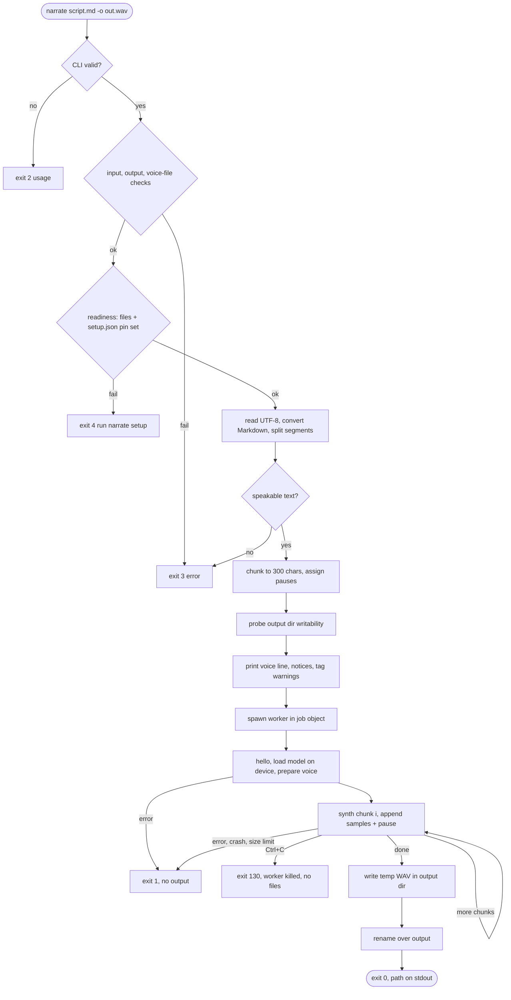
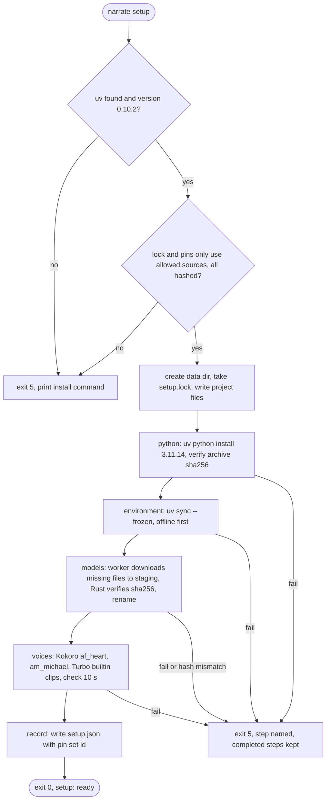
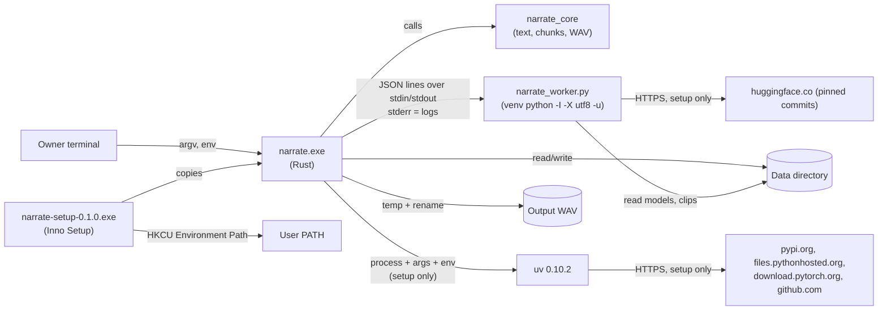

# spec-narrate-architecture

## Metadata

| Field | Value |
|---|---|
| **Feature** | narrate Phase 1: system architecture (Rust CLI, Python worker, data directory, installer) |
| **Parent feature** | None |
| **Sub-features** | spec-narrate-cli.md, spec-narrate-text-pipeline.md, spec-narrate-generation.md, spec-narrate-worker.md, spec-narrate-setup.md, spec-narrate-installer.md, spec-narrate-test-strategy.md |
| **Requirement refs** | BR-001, BR-002, BR-003, UR-001, UR-002, UR-003, UR-004, UR-005, UR-006, UR-007, UR-010, FR-001, FR-002, FR-003, FR-004, FR-005, FR-006, FR-007, FR-008, FR-009, FR-010, FR-011, FR-012, FR-013, FR-014, FR-015, FR-016, FR-017, FR-018, FR-024, NFR-001, NFR-002, NFR-003, NFR-004, NFR-005, NFR-006, NFR-007, NFR-008, NFR-009, NFR-011, NFR-012 |
| **Feature type** | Architecture |
| **Status** | Review |

Status values: Draft, Review, Approved, Implemented.

Change Log 2026-10-13 (end of this file) modifies the `pyproject.toml` line of the workspace layout, the topology host list, and Requirement: Workspace manifest and Requirement: Pinned inputs have stable line endings (single-line forms), and adds a design decision. Where the change log and the body differ, the change log wins.

Inputs: `docs/requirements.md`, `docs/research/README.md`, `docs/research/phase1-python-runtime.md` (cited below as "research P1 section N" or "research F<n>"), `docs/research/installer.md` (cited as "research installer section N"), `DECISIONS.md`. Phase 2 (`narrate-onnx`, FR-019 to FR-023, FR-025, FR-026) is out of scope here and gets a delta spec; this spec only reserves room for it.

## Description

`narrate` is a Rust command-line program that turns a Markdown or text script into a 24 kHz mono WAV file by driving the official `chatterbox-tts` 0.1.7 Chatterbox-Turbo model in a private, version-pinned Python environment that `narrate setup` builds with uv 0.10.2. The Rust side owns everything observable (CLI, text conversion, chunking, silences, WAV writing, readiness checks, pins, error messages); a single-file Python worker owns only model work and pinned Hugging Face downloads, and talks to Rust over JSON lines. All Python, model, cache, and voice-clip state lives in one data directory so the installed binary and development builds share one setup, and nothing outside that directory changes except the output WAV, the user PATH entry, and the installer's uninstall registration (UR-010, NFR-002).

## Components

| Component | Responsibility | Owns data | Technology |
|---|---|---|---|
| `narrate` binary (crate `narrate`, `crates/narrate/`) | CLI parsing, error catalog, generation orchestration, worker process host, setup orchestration, readiness check and `status`, pin set and allow-list check | Embedded pin set (`pins.json`, `pyproject.toml`, `uv.lock`, worker script), output WAV, `setup.json` | Rust 1.99, edition 2024 |
| `narrate-core` library (crate `narrate_core`, `crates/narrate-core/`) | Script loading and decoding, Markdown-to-speech conversion, tag handling, sentence splitting and chunking, pause sample counts, WAV encoding, reference-clip inspection and trimming | None (pure functions plus file IO helpers) | Rust 1.99, edition 2024; `pulldown-cmark`, `hound` |
| Python worker (`python/narrate_worker.py`) | Load Chatterbox-Turbo from local files, cache one voice conditioning per voice, synthesize chunks with the PerTh watermark, render Kokoro reference clips, download pinned Hugging Face files | Nothing persistent; writes only to paths `narrate` passes | CPython 3.11.14, `chatterbox-tts` 0.1.7, torch 2.6.0+cu124, `kokoro` 0.9.4 |
| Worker environment (`python/pyproject.toml`, `python/uv.lock`) | Declares the locked dependency set (research P1 section 3.2) | `uv.lock` (every artifact with sha256) | uv 0.10.2 project, `package = false` |
| uv 0.10.2 (external, installed by the Owner) | Install CPython 3.11.14, sync the venv from the frozen lock | uv cache, Python installs (redirected into the data directory) | uv |
| Data directory (`%LOCALAPPDATA%\narrate` or `NARRATE_DATA_DIR`) | Holds every runtime artifact (layout below) | Python, venv, models, clips, caches, logs, `setup.json` | NTFS directory |
| Installer (`installer/narrate.iss`, `installer/build.ps1`) | Per-user install of `narrate.exe` under `%LOCALAPPDATA%\Programs\narrate`, user PATH add and remove | Install directory, HKCU uninstall key, one user PATH entry | Inno Setup 6.7.3 |
| Test kit (crate `narrate-testkit`, `crates/narrate-testkit/`, test-only) | Fake worker, fake uv, allow-list proxy, console-signal helper for black-box tests | None | Rust; written by the developer-tester |

## Cargo workspace layout

The repository root is a virtual workspace. Phase 2 adds `crates/narrate-onnx/` without editing any Phase 1 manifest because members are a glob.

```text
Cargo.toml                    virtual workspace manifest (developer)
Cargo.lock                    committed
.gitattributes                eol=lf for pinned inputs (developer)
crates/
  narrate-core/               lib crate narrate_core (developer); tests/ (developer-tester)
  narrate/                    bin crate narrate (developer); pins.json; tests/ (developer-tester)
  narrate-testkit/            test-only bins (developer-tester, whole package)
  narrate-onnx/               reserved for Phase 2; does not exist in Phase 1
python/
  pyproject.toml              research P1 section 3.2, verbatim (developer)
  uv.lock                     committed, generated with uv 0.10.2 (developer)
  narrate_worker.py           single-file worker (developer)
installer/
  narrate.iss                 Inno Setup script (developer)
  build.ps1                   build script that finds ISCC (developer)
qa/                           GPU and manual QA assets (developer-tester), see spec-narrate-test-strategy.md
dist/                         installer output, git-ignored
```

### Requirement: Workspace manifest

The root `Cargo.toml` SHALL declare a virtual workspace with `members = ["crates/*"]`, `resolver = "3"`, `[workspace.package]` with `edition = "2024"`, `rust-version = "1.99"`, `version = "0.1.0"`, and the `[workspace.dependencies]` table below with exact (`=`) versions.

| Dependency | Requirement string | Used by | Source of version |
|---|---|---|---|
| `anyhow` | `=1.0.104` | narrate | research P1 section 6 |
| `thiserror` | `=2.0.21` | narrate-core, narrate | research P1 section 6 |
| `clap` | `=4.6.7`, features `["derive"]` | narrate | research P1 section 6 |
| `serde` | `=1.0.229`, features `["derive"]` | narrate, narrate-testkit | research P1 section 6 |
| `serde_json` | `=1.0.154` | narrate, narrate-testkit | research P1 section 6 |
| `pulldown-cmark` | `=0.13.4`, `default-features = false` | narrate-core | research P1 section 6 |
| `hound` | `=3.5.1` | narrate-core; dev-dependency of narrate | research P1 section 6 |
| `dirs` | `=7.0.0` | narrate | research P1 section 6 |
| `sha2` | `=0.11.0` | narrate | research P1 section 6 |
| `ctrlc` | `=3.5.2` | narrate | research P1 section 6 |
| `assert_cmd` | `=2.2.2` | dev-dependency of narrate | research P1 section 6 |
| `predicates` | `=3.1.4` | dev-dependency of narrate | research P1 section 6 |
| `tempfile` | `=3.27.0` | dev-dependency of narrate and narrate-core | research P1 section 6 |
| `windows-sys` | `=0.61.2`, features `["Win32_Foundation", "Win32_Security", "Win32_System_JobObjects", "Win32_System_Threading", "Win32_System_Console"]` | narrate, narrate-testkit | Not in the research notes; Microsoft's official crate; newest crates.io release verified by the coordinator on 2026-10-12. `Win32_Security` is required because `CreateJobObjectW` takes a `SECURITY_ATTRIBUTES` pointer. Code (including the tester's test kit) SHALL NOT name the `BOOL` or `HANDLE` types, whose module paths and definitions differ between `windows-sys` releases; bind return values with type inference and compare `BOOL` results with `!= 0` |

No TOML parser is a dependency: `uv.lock` is validated by the fail-closed line scanner in spec-narrate-setup.md (Requirement 1), and `pins.json` is JSON (`serde_json`).

#### Scenario: Workspace builds

- **GIVEN** a clean checkout with Rust 1.99
- **WHEN** `cargo build --workspace` runs
- **THEN** it SHALL succeed and produce `target\debug\narrate.exe`
- **AND** `Cargo.toml` SHALL list `crates/*` as members and edition 2024

#### Scenario: Missing member does not break the build

- **GIVEN** `crates/narrate-testkit/` does not exist yet (the developer works before the tester's files arrive)
- **WHEN** `cargo build --workspace` runs
- **THEN** it SHALL succeed, because members are matched by glob

### Requirement: Crate manifests

`crates/narrate-core/Cargo.toml` SHALL define package `narrate-core` (lib name `narrate_core`) with no binaries. `crates/narrate/Cargo.toml` SHALL define package `narrate` with exactly one binary `narrate` (`src/main.rs`), a feature `test-hooks` that is off by default, a dependency on `narrate-core` by path, and `[dev-dependencies]` `assert_cmd`, `predicates`, `tempfile`, `hound`, `serde_json` (workspace versions). `crates/narrate-core/Cargo.toml` SHALL list `tempfile` as a dev-dependency.

#### Scenario: Release build excludes test hooks

- **GIVEN** the workspace
- **WHEN** `cargo build --release -p narrate` runs
- **THEN** `target\release\narrate.exe --version` SHALL print exactly `narrate 0.1.0`

#### Scenario: Test build includes test hooks

- **GIVEN** the workspace
- **WHEN** `cargo build -p narrate --features test-hooks` runs
- **THEN** `narrate --version` SHALL print `narrate 0.1.0 (test hooks enabled)`

### Requirement: Pinned inputs have stable line endings

`.gitattributes` SHALL mark `crates/narrate/pins.json`, `python/pyproject.toml`, `python/uv.lock`, and `python/narrate_worker.py` as `text eol=lf`, so the pin set identifier (spec-narrate-setup.md) is identical on every checkout.

#### Scenario: Line endings fixed

- **GIVEN** a checkout on Windows with `core.autocrlf=true`
- **WHEN** the four files are read
- **THEN** none SHALL contain a carriage return byte

## Data directory layout

The data directory `D` is `std::path::absolute(<value>)` of `NARRATE_DATA_DIR` when that variable is set and non-empty, else `dirs::data_local_dir()` joined with `narrate` (research P1 section 6: `{FOLDERID_LocalAppData}`); it is never canonicalized. Every path below is `D` joined with the fixed components shown, and every printed or sent path follows the path rule in spec-narrate-cli.md (Line catalog). `narrate` never reads or writes outside this directory except the output WAV and its temporary file (FR-006), and never deletes entries it does not own.

| Path | Written by | Contents |
|---|---|---|
| `setup.json` | setup step `record` | Setup record: format and pin set identifier (spec-narrate-setup.md) |
| `setup.lock` | setup | Exclusive lock file held while setup runs |
| `project\pyproject.toml`, `project\uv.lock`, `project\pins.json` | setup step `preflight` | Byte copies of the files embedded in the binary (the full pin set, readable by the Owner) |
| `worker\<h12>\narrate_worker.py` | any command that starts a worker | Embedded worker script; `<h12>` is the first 12 lowercase hex digits of its sha256 |
| `python\` | setup step `python` | `UV_PYTHON_INSTALL_DIR` |
| `python-cache\` | setup step `python` | `UV_PYTHON_CACHE_DIR` (python-build-standalone archive) |
| `uv-cache\` | setup step `environment` | `UV_CACHE_DIR` |
| `venv\` | setup step `environment` | `UV_PROJECT_ENVIRONMENT` |
| `models\chatterbox-turbo\` | setup step `models` | The 9 Turbo files (research P1 section 2.1) |
| `models\kokoro-82m\` | setup step `models` | `kokoro-v1_0.pth`, `config.json`, `voices\af_heart.pt`, `voices\am_michael.pt` |
| `voices\female.wav`, `voices\male.wav`, `voices\builtin.wav` | setup step `voices` | Reference clips, 24 kHz mono 16-bit PCM, at least 10 s; Phase 2 `narrate-onnx` reads all three, using `builtin.wav` for its builtin voice (FR-010, FR-019) |
| `staging\` | setup, generation | Downloads before verification, clip renders, trimmed custom clips |
| `tmp\<run>\` | every command that starts a child | `TEMP` and `TMP` of every uv and worker child (`<run>` = `<narrate pid>-<start Unix ms>`); created only once `D` exists (never by setup preflight); removed when the command ends, together with `tmp\` when it is left empty; entries older than 24 hours removed after setup preflight and after the generation readiness check (spec-narrate-setup.md, Child process environment) |
| `hf-home\` | worker | `HF_HOME`; `hf-home\hub`, `hf-home\xet`, `hf-home\assets` |
| `torch-home\`, `numba-cache\`, `cuda-cache\`, `mpl-config\` | worker | Redirected library caches |
| `logs\` | setup, generation | `setup-last.log`, `worker-<pid>.log` |
| `onnx\` | reserved for Phase 2 | `narrate` never reads, writes, or deletes it |

### Requirement: Data directory resolution

The system SHALL resolve the data directory from `NARRATE_DATA_DIR` when it is set and non-empty, and otherwise from `%LOCALAPPDATA%\narrate`, and SHALL NOT create it from `status` or generation.

#### Scenario: Override honored

- **GIVEN** `NARRATE_DATA_DIR` names an empty scratch directory
- **WHEN** the user runs `narrate status`
- **THEN** stdout SHALL contain `data directory: <that directory>`
- **AND** `%LOCALAPPDATA%\narrate` SHALL be unchanged (same existence, same top-level entries)

#### Scenario: Missing directory not created

- **GIVEN** `NARRATE_DATA_DIR` names a directory that does not exist
- **WHEN** the user runs `narrate status`
- **THEN** the command SHALL exit 4 and the directory SHALL still not exist

## Data flow

Rendering note: mermaid-cli (`mmdc`) is not installed on this machine, so diagrams are embedded as Mermaid source. To render: `npm install -g @mermaid-js/mermaid-cli`, then `mmdc -i <file>.mmd -o <file>.png`, or paste into https://mermaid.live.

### Generation data flow (start to end)



### Setup data flow (start to end)



### Requirement: Generation flow from script to WAV

The system SHALL convert a script file into one WAV file by passing chunk texts from `narrate` to the worker and assembling the returned samples with exact pause samples in `narrate`, and SHALL write the output only after every chunk succeeded.

#### Scenario: Successful path

- **GIVEN** a ready data directory and `story.md` with two paragraphs
- **WHEN** the user runs `narrate story.md`
- **THEN** the system SHALL write `story.wav` (24 kHz, mono, 16-bit PCM) next to the input
- **AND** stdout SHALL be exactly the absolute path of `story.wav` followed by a newline
- **AND** the command SHALL exit 0

#### Scenario: Worker failure on one chunk

- **GIVEN** a ready data directory and a worker that fails chunk 3 of 5
- **WHEN** generation runs
- **THEN** the system SHALL stop, exit 1, name chunk 3 of 5, and leave no output or temporary file
- **AND** the system SHALL NOT retry the chunk (retrying with the same seed reproduces the same failure)

#### Scenario: Not set up

- **GIVEN** an empty data directory
- **WHEN** the user runs `narrate story.md`
- **THEN** the system SHALL exit 4 with `error[not-set-up]` before reading the script or starting a worker

### Requirement: Setup flow from pins to ready data directory

The system SHALL build the data directory through the ordered steps `preflight`, `python`, `environment`, `models`, `voices`, `record`, each of which skips work that is already complete and verified, and SHALL write `setup.json` only after all other steps succeed.

#### Scenario: First setup

- **GIVEN** network access, uv 0.10.2 on PATH, and an empty data directory
- **WHEN** the user runs `narrate setup`
- **THEN** every step SHALL report `ok` and the last line SHALL be `setup: ready`
- **AND** `narrate status` SHALL exit 0

#### Scenario: Retry after a transient failure

- **GIVEN** a setup that failed in step `models` because the network dropped
- **WHEN** the user runs `narrate setup` again with the network restored
- **THEN** steps `python` and `environment` SHALL report `ok (no network used)`
- **AND** the `models` step SHALL download only files that are missing or fail verification, and setup SHALL end with `setup: ready`

#### Scenario: Permanent failure on hash mismatch

- **GIVEN** a pinned file whose downloaded bytes do not match the pinned sha256
- **WHEN** setup verifies it
- **THEN** setup SHALL delete the downloaded file, exit 5 with `error[hash-mismatch]` naming the file, and SHALL NOT write `setup.json`

### Requirement: Status flow

The system SHALL compute readiness from file existence in the data directory and the pin set identifier in `setup.json`, and SHALL query CUDA availability through a short-lived worker only when the environment is present.

#### Scenario: Ready report

- **GIVEN** a complete data directory set up with the running binary's pin set
- **WHEN** the user runs `narrate status`
- **THEN** stdout SHALL end with `status: ready` and the command SHALL exit 0

#### Scenario: Not-ready report

- **GIVEN** `models\chatterbox-turbo\conds.pt` is missing
- **WHEN** the user runs `narrate status`
- **THEN** stdout SHALL contain `turbo weights: missing (conds.pt)` and end with `status: not ready (run narrate setup)`
- **AND** the command SHALL exit 4

## Topology



## Cloud boundaries

Not applicable: everything runs on the Owner's Windows machine; the only remote contact is setup downloading from the allow-listed sources in spec-narrate-setup.md.

## Failure modes

| Failure | Impact | Detection | Mitigation |
|---|---|---|---|
| uv missing or wrong version | Setup cannot build the environment | `uv --version` in preflight | Exit 5 before any download, print the pinned install command (FR-011) |
| Network drop during setup | Step incomplete | Non-zero exit of uv or a worker `download_failed` error | Exit 5 naming the step; staging keeps partial downloads; re-run resumes (FR-010) |
| Downloaded file hash differs from pin | Supply-chain or corruption risk | sha256 in Rust (models, Python archive); uv for wheels (research P1 section 7) | Delete the file, exit 5, never install or use it (NFR-001) |
| `pkg_resources` missing, PerTh becomes `None` | Turbo load fails or output unwatermarked | Worker checks the watermarker at load (research F1) | `setuptools==81.0.0` pinned; load fails with `watermark-unavailable`; no output written (FR-018) |
| Library prints on stdout | Corrupts the JSON channel | Worker channel isolation (research F6) | Private dup of fd 1; fd 1 and `sys.stdout` point to stderr |
| Worker crash or OOM mid-run | No audio for that chunk | stdout EOF or `out_of_memory` error | Exit 1 naming the chunk; nothing written (FR-005) |
| Ctrl+C or `narrate` killed | Orphan worker holding VRAM | ctrlc handler; job object kill-on-close; worker stdin EOF watchdog | Worker gone within 10 s; no output or temporary file (FR-005) |
| CUDA unavailable | Slow CPU run or failure | Worker `load` reply | `auto` warns and uses CPU; `cuda` exits 1 (FR-013) |
| Pin set changed by a newer binary | Data directory built for other pins | `setup.json` pin set id differs | `status` reports mismatch; generation exits 4 (FR-017) |
| Audio exceeds 4 GiB WAV limit | Unwritable RIFF file | Running size check after each chunk | Exit 1 with the limit stated; nothing written (NFR-005) |
| Output locked or not writable | Run cannot finish | Writability probe before generation; rename error | Exit 3 before generation, or exit 3 at the end with the earlier output unchanged (FR-006) |
| Other apps hold most of the VRAM | Slow run (driver falls back to shared memory) | QA VRAM baseline (research F8, section 9) | QA frees VRAM and records the baseline; not a narrate behavior |

## Non-functional requirements addressed

| NFR | Target | How this architecture achieves it |
|---|---|---|
| NFR-001 | Every Python artifact and HF file pinned and hash-verified | `uv.lock` with sha256 for every artifact, `uv sync --frozen`; HF files fetched by commit and verified in Rust against `pins.json`; Python archive verified against the pinned sha256 |
| NFR-002 | No change outside the data directory except output WAV and its temp file | Every child process gets the redirected environment in spec-narrate-setup.md; `--no-bin --no-registry`; worker runs `-I`; caches redirected |
| NFR-003 | No admin rights | Per-user install (`PrivilegesRequired=lowest`), data in `%LOCALAPPDATA%`, uv Python without registry |
| NFR-004 | Female median F0 >= 165 Hz, male <= 155 Hz; builtin reported | QA procedure with a fixed script, `librosa.pyin` estimator, and voiced-frame rule in spec-narrate-test-strategy.md |
| NFR-005 | 10,000-word script on 8 GB GPU; 4 GiB WAV limit | Chunks of at most 300 characters keep each model call small; audio held as 16-bit samples in memory (about 192 MB for 67 minutes, estimate); size check after every chunk |
| NFR-006 | RTF below 1.0 on CUDA (estimate) | Model loaded once per run; one cached conditioning per voice; `done:` line reports RTF |
| NFR-007 | Cause and next action; no stack trace without `--verbose` | Error catalog in spec-narrate-cli.md: `error[<code>]:` plus `  fix:` line; worker tracebacks only under `--verbose` or in the log file |
| NFR-008 | Exit 0 on success, non-zero on failure | Exit code table in spec-narrate-cli.md |
| NFR-009 | Windows 11 x64 | `x86_64-pc-windows-msvc` target; installer `x64compatible`; lock restricted to `win32` `AMD64` |
| NFR-011 | Owner accepts voice quality by listening | Manual check in spec-narrate-test-strategy.md |
| NFR-012 | RTF recorded in the QA report | `done:` line format fixed in spec-narrate-generation.md; QA records it |

## Design decisions

| Decision | Options considered | Chosen | Rationale |
|---|---|---|---|
| Rust-to-model integration | PyO3 embedding; `uv run` per chunk; one long-lived worker per command over pipes | Long-lived worker started with the venv's `python.exe -I -X utf8 -u <script>` | Model loads once per run (NFR-006); process boundary isolates crashes and VRAM; `-I -X utf8` fixes cp1252 pipes (research F6); no uv at run time |
| Python environment split (FR-010) | One env; separate Kokoro env | One env (`python/pyproject.toml` from research P1 section 3.2) | The 153-package set resolves together (research P1 section 3.2). Risk: Kokoro under transformers 5.2.0 is unverified (research P1 section 4), and kokoro retries `load_state_dict` with `strict=False`, so a mismatch can yield bad clips rather than an error. Mitigations: the developer locks with `uv lock --exclude-newer 2026-10-13T00:00:00Z` (no drift; if uv cannot resolve `torch` or `torchaudio` from the PyTorch index because its files carry no upload date, the developer locks without `--exclude-newer`, checks the key pins, and reports the change) and renders one Kokoro clip and one Turbo chunk in a scratch environment before writing the `voices` step (spec-narrate-setup.md, Developer procedure for step 3a); QA checks the median F0 of `female.wav` and `male.wav` themselves (spec-narrate-test-strategy.md, GPU QA item 5). If either fails, a delta spec adds a second project |
| Model download | Rust HTTP client; `from_pretrained`; worker `hf_hub_download` per file plus Rust sha256 | Worker downloads each pinned file at the pinned commit into `staging\`, Rust verifies sha256 and size, then renames | `from_pretrained` cannot pin a revision (research F4); no HTTP crate was researched; Rust owns the hash table |
| Pin set source | Files shipped next to the exe; files embedded in the binary | `pins.json`, `pyproject.toml`, `uv.lock`, and the worker script embedded with `include_str!` | "The running binary's pin set" (FR-017) is exact; installer ships one file |
| Output WAV encoding | 16-bit PCM; 32-bit float | 16-bit PCM, 24 kHz, mono | Plays in every editor and device; half the size (24.8 h fits in 4 GiB vs 12.4 h); 16-bit quantization noise sits near -96 dBFS; whether PerTh survives it is not in the research, so QA runs the PerTh extractor on the shipped 16-bit output (FR-018) and a failed detection returns this decision to the architect |
| Audio transport worker to Rust | Files in staging; base64 in JSON; hex in JSON | Little-endian float32 samples as lowercase hex in the `synth` reply | No temp files during generation; no extra crate; about 3.8 MB per 20 s chunk (estimate) |
| Audio assembly | Stream to temp WAV; hold in memory | Hold 16-bit samples in memory, write temp file once at the end, rename | No temp file exists in the output directory during generation, so a killed run leaves nothing (FR-005); about 192 MB for 10,000 words (estimate) |
| Chunk size | Token-based; character-based | At most 300 characters per chunk, sentence-packed | Research P1 section 1.6 estimate (about 20 s of speech) keeps well under the 40 s and 1024-token caps (research F5); QA measures seconds per character |
| Pauses | Model punctuation only; explicit silence | Explicit zero samples: chunk 4800, table cell 7200, paragraph 12000, heading 19200 (at 24 kHz) | Exact, testable sample counts (FR-005) |
| Custom clip longer than 10 s | Pass whole clip; trim | `narrate` writes the first 10 s to `staging\` and passes that | Makes the FR-009 notice true for every conditioning path (Turbo would use up to 15 s for T3, research P1 section 1.5) and matches Phase 2's 10 s encoder cap |
| Interruption and orphan prevention | Job object only; stdin EOF only; both | Children (worker and uv) spawned with `CREATE_NEW_PROCESS_GROUP \| CREATE_NO_WINDOW` so console Ctrl+C and Ctrl+Break reach only `narrate`; job object with kill-on-close; worker stdin EOF watchdog; 3 s grace then terminate on Ctrl+C; 500 ms wait for a pending interrupt before reporting a worker exit | Only `narrate` decides how a run ends, so an interrupt is never misreported as a worker crash; kill-on-close covers `narrate` being killed; the watchdog covers non-job launches; the grace kill bounds Ctrl+C (FR-005) |
| Readiness check | Hash every file each run; existence plus setup record | Existence of every required file plus `setup.json` pin set id; hashes verified only during setup | Files reach final paths only after verification (temp-then-rename), so existence is sound; status stays fast |
| Python build verification (FR-011) | Trust uv; download the archive ourselves; hash uv's cached archive | Set `UV_PYTHON_CACHE_DIR` and require a file there whose sha256 equals the pinned value | Uses only researched uv features (research P1 section 8). Assumption to confirm in step 3a: uv 0.10.2 keeps the archive in that directory. If it does not, the developer reports it; the fallback is downloading the pinned URL with Windows `curl.exe`, verifying it, and serving it through `UV_PYTHON_INSTALL_MIRROR=file:///...` (a delta spec) |
| Test hooks and test overrides | Always on; cargo feature | Cargo feature `test-hooks`, off in release | Release binary cannot be redirected to another worker, uv, or lockfile by environment variables |
| Fake worker | Python script; PowerShell; Rust bin | Rust bin `narrate-test-worker` in `crates/narrate-testkit` | No Python needed for CLI tests; `cargo test --workspace` builds it |
| Uninstall and the data directory | Delete with `[UninstallDelete]`; keep | Keep `%LOCALAPPDATA%\narrate` on uninstall | Several GB shared with development builds and Phase 2; reinstall keeps setup; README documents manual removal |
| Phase 2 readiness | Shared lib edited later; frozen shared lib | `narrate-core` API frozen at Phase 1; Phase 2 may add modules, not change existing behavior; same installer AppId; `onnx\` reserved in the data directory | FR-022 keeps `narrate` unchanged |
| F0 thresholds | Strict (> 165, < 155); inclusive | Inclusive: female >= 165.0 Hz, male <= 155.0 Hz | NFR-004 text ("at least", "at most") governs over the plan's wording |

## Sub-feature breakdown

| Sub-feature | Spec file | Description |
|---|---|---|
| CLI contract | spec-narrate-cli.md | Grammar, options, defaults, exit codes, every stdout/stderr line format, error catalog, environment variables, test hooks |
| Text pipeline | spec-narrate-text-pipeline.md | Public `narrate_core` API: decoding, Markdown rules, tags, sentences, chunks, pauses |
| Generation | spec-narrate-generation.md | `narrate <file>` orchestration: checks, voices, device, worker session, assembly, WAV, interruption |
| Worker | spec-narrate-worker.md | Python worker launch, channel isolation, JSON-lines protocol, model and voice handling, hooks, fake-worker conformance |
| Setup and status | spec-narrate-setup.md | Pins, allow-list, setup steps, clips, setup record, readiness, `status` |
| Installer | spec-narrate-installer.md | Inno Setup script, PATH handling, build script, uninstall policy |
| Test strategy | spec-narrate-test-strategy.md | Test locations, dev-dependencies, test kit, coverage map, GPU QA and manual checks |

## Submodule scope

Not applicable: the repository has no git submodules.

## Error handling

| Error condition | Handling strategy | Outcome |
|---|---|---|
| User error (arguments, input, output, voice clip) | Validate before any worker starts | Exit 2 or 3 with `error[<code>]` and `fix:` line; nothing written |
| Setup incomplete or pin mismatch | Readiness check before reading the script | Exit 4 pointing to `narrate setup` |
| Worker or model failure | Map worker error codes to catalog codes; kill worker | Exit 1; earlier output file untouched |
| Setup step failure | Stop at the failing step; keep completed steps | Exit 5 naming the step |
| Interrupt | Stop worker within 10 s, remove temp files | Exit 130 |

Full catalog: spec-narrate-cli.md.

## Events

| Event name | Producer | Consumer(s) | Payload summary | Guarantee |
|---|---|---|---|---|
| Worker request (`hello`, `probe`, `load`, `voice`, `synth`, `kokoro_clip`, `download`, `shutdown`) | `narrate` | Worker | One JSON object per line on worker stdin with `id` and `op` | Sequential; one outstanding request at a time |
| Worker response | Worker | `narrate` | One JSON object per line on the private stdout handle with matching `id`, `ok`, result or `error` | Exactly one response per request, or process exit |

Schemas: spec-narrate-worker.md.

## Traceability

| Requirement | Spec section | Verified by |
|---|---|---|
| BR-001 | Requirement: Generation flow from script to WAV | CLI tests (spec-narrate-test-strategy.md); GPU QA |
| BR-002 | Sub-feature: spec-narrate-installer.md | Devops install check (step 5) |
| BR-003 | Requirement: Setup flow from pins to ready data directory; Design decisions | GPU QA real setup with allow-list proxy |
| UR-001 to UR-007, UR-010 | Sub-feature specs (see their traceability tables) | As listed in spec-narrate-test-strategy.md |
| FR-001 to FR-018, FR-024 | Sub-feature specs | As listed in spec-narrate-test-strategy.md |
| FR-017 | Requirement: Data directory resolution | CLI tests with `NARRATE_DATA_DIR` |
| NFR-001 to NFR-009, NFR-011, NFR-012 | Non-functional requirements addressed | As listed in spec-narrate-test-strategy.md |
| FR-011, NFR-001 (2026-10-13) | Change Log 2026-10-13: workspace layout `pyproject.toml` line; topology hosts; ADDED design decision on builds | `crates/narrate/tests/pins.rs`; GPU QA item 14 |
| FR-017 (2026-10-13) | Change Log 2026-10-13: single-line manifest and `.gitattributes` forms | `crates/narrate/tests/pins.rs` |

## Change Log: 2026-10-13

**Source:** User decisions in `DECISIONS.md` dated 2026-10-13 ("PyTorch wheel host"; "Build backend for source-only packages"), which apply FR-011 and NFR-001; and a test-contract clarification from plan step 3a for the repository-inspection test (`crates/narrate/tests/pins.rs` reads each dependency and each `.gitattributes` rule as one line). `docs/requirements.md` is unchanged.

### ADDED Requirements

#### Requirement: Design decision, builds of sdist-only packages

The design decisions table SHALL include this row: Decision "Building sdist-only packages (`docopt` 0.6.2)"; Options considered "uv's default isolated build environment (fetches an unpinned `setuptools`); constrained isolated build with a hashed build-constraints file; no build isolation for `docopt`, using the locked `setuptools` 81.0.0 already installed from `uv.lock`"; Chosen "no build isolation for `docopt` in a second sync phase, after a first phase with `--no-build` that fails closed for any other package that would need a build; the hashed build-constraints file is the fallback"; Rationale "every byte installed or executed during setup comes from `uv.lock` with a sha256 check (user decision 2026-10-13); research P1 sections 3.2 and 3.4 missed `docopt` being sdist-only". Details: spec-narrate-setup.md, Change Log 2026-10-13, Requirement 3.

##### Scenario: Decision recorded

- **GIVEN** this spec
- **WHEN** a reviewer reads the design decisions and this change log
- **THEN** the build decision, its fallback, and the research correction SHALL be stated, and spec-narrate-setup.md SHALL define the two sync phases

### MODIFIED Requirements

#### Requirement: Cargo workspace layout, `python/pyproject.toml` line

**Was:** "`pyproject.toml              research P1 section 3.2, verbatim (developer)`"
**Now:** `pyproject.toml              research P1 section 3.2 plus [tool.uv] no-build-isolation-package = ["docopt"] and build-constraint-dependencies = ["setuptools==81.0.0"] (developer; spec-narrate-setup.md, Change Log 2026-10-13)`. The "Worker environment" component row reads "Declares the locked dependency set (research P1 section 3.2, plus the two build keys)".
**Reason:** User decision 2026-10-13, "Build backend for source-only packages".

##### Scenario: pyproject differs from research only by the build keys

- **GIVEN** `python/pyproject.toml`
- **WHEN** it is compared with research P1 section 3.2
- **THEN** the only differences SHALL be the two `[tool.uv]` keys above

#### Requirement: Topology, setup download hosts

**Was:** the topology node `SRC1` lists "pypi.org, files.pythonhosted.org, download.pytorch.org, github.com".
**Now:** `SRC1` lists `pypi.org`, `files.pythonhosted.org`, `download.pytorch.org`, `download-r2.pytorch.org`, `github.com`. The allow-list itself is defined in spec-narrate-setup.md (Change Log 2026-10-13).
**Reason:** User decision 2026-10-13, "PyTorch wheel host".

##### Scenario: Host lists agree

- **GIVEN** this spec and spec-narrate-setup.md
- **WHEN** a reviewer compares the topology hosts with the QA proxy allow-list
- **THEN** every host uv contacts for PyTorch (`download.pytorch.org`, `download-r2.pytorch.org`) SHALL appear in both

#### Requirement: Workspace manifest and crate manifests, single-line dependency form

**Was:** "...and the `[workspace.dependencies]` table below with exact (`=`) versions." (no line form stated)
**Now:** In the root `Cargo.toml`, each `[workspace.dependencies]` entry SHALL be written on exactly one line, either `name = "=x.y.z"` or `name = { version = "=x.y.z", ... }` with all of its keys (features, `default-features`) on that line. For example: `windows-sys = { version = "=0.61.2", features = ["Win32_Foundation", "Win32_Security", "Win32_System_JobObjects", "Win32_System_Threading", "Win32_System_Console"] }`. In `crates/*/Cargo.toml`, each workspace dependency under `[dependencies]` or `[dev-dependencies]` SHALL also be one line, `name.workspace = true` or `name = { workspace = true, ... }`. Versions and features are unchanged.
**Reason:** The repository-inspection test reads each dependency as a single line. A multi-line inline table or a `[workspace.dependencies.name]` subtable would hide its version and features from that test.

##### Scenario: windows-sys on one line

- **GIVEN** the root `Cargo.toml`
- **WHEN** the `[workspace.dependencies]` line starting with `windows-sys` is read
- **THEN** that single line SHALL contain `"=0.61.2"` and all five features

#### Requirement: Pinned inputs have stable line endings, `.gitattributes` form

**Was:** "`.gitattributes` SHALL mark `crates/narrate/pins.json`, `python/pyproject.toml`, `python/uv.lock`, and `python/narrate_worker.py` as `text eol=lf`..." (no line form stated)
**Now:** The developer owns `.gitattributes`. Each of the four files SHALL have its own line of the form `<repo-relative path with forward slashes> text eol=lf`, for example `python/uv.lock text eol=lf`. Comment lines are allowed. If the fallback `python/build-constraints.txt` of spec-narrate-setup.md (Change Log 2026-10-13, Requirement 3) is used, it gets a fifth line of the same form.
**Reason:** The repository-inspection test looks for one line that contains each path, `text`, and `eol=lf`.

##### Scenario: One rule per pinned file

- **GIVEN** `.gitattributes`
- **WHEN** it is read line by line
- **THEN** for each pinned file there SHALL be a line containing its path, `text`, and `eol=lf`

### REMOVED Requirements

None.
