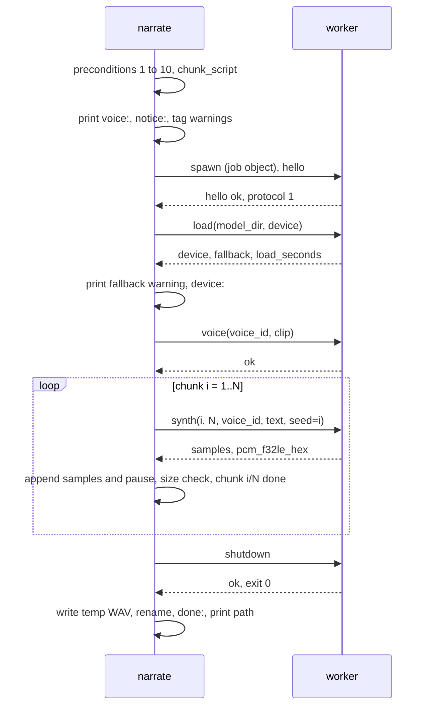

# spec-narrate-generation

## Metadata

| Field | Value |
|---|---|
| **Feature** | `narrate <file>`: generation orchestration, voices, device, WAV output, interruption |
| **Parent feature** | spec-narrate-architecture.md |
| **Sub-features** | None |
| **Requirement refs** | UR-001, UR-002, UR-004, UR-006, UR-007, FR-001, FR-004, FR-005, FR-006, FR-007, FR-008, FR-009, FR-012, FR-013, FR-015, FR-017, FR-018, NFR-002, NFR-005, NFR-006, NFR-007, NFR-008, NFR-012 |
| **Feature type** | Functionality |
| **Status** | Draft |

Status values: Draft, Review, Approved, Implemented.

## Description

The generation command validates everything it can without the model, checks that setup is complete for the running binary's pin set, converts and chunks the script with `narrate_core`, then drives one worker session (spec-narrate-worker.md) chunk by chunk, appending each chunk's samples and its pause into an in-memory 16-bit buffer. Only after the last chunk succeeds does it write a temporary WAV in the output directory and rename it over the output path, so a failed or interrupted run leaves no new file and any earlier output unchanged. Exact line formats and error codes come from spec-narrate-cli.md.

## Triggered by

| Trigger type | Source | Condition |
|---|---|---|
| User action | `narrate [--verbose] <FILE> [-o PATH] [--voice V \| --voice-file WAV] [--device D]` | No subcommand given |

## Required data

| Data | Source | Type | Notes |
|---|---|---|---|
| `<FILE>` | CLI | Path | Relative paths resolve against the current directory |
| Output path | `-o` or derived | Path | Default: `<FILE>` with extension replaced by `wav` (`a.b.txt` gives `a.b.wav`; `INTRO.MD` gives `INTRO.wav`) |
| Voice | `--voice`, `--voice-file` | Enum or path | Neither given means `female` |
| Device | `--device` | `auto`, `cuda`, `cpu` | Default `auto` |
| Data directory | spec-narrate-architecture.md (Data directory resolution) | Path | |
| Readiness | spec-narrate-setup.md (Requirement: Readiness check) | Component report | |
| WAV size limit | `NARRATE_TEST_WAV_LIMIT_BYTES` in test builds, else 4294967295 | Bytes | NFR-005 |

## Preconditions

Checked in this order; the first failure ends the run with nothing written.

| # | Condition | Check | If not met |
|---|---|---|---|
| 1 | Extension allowed | `ScriptKind::from_path` | `input-extension`, exit 3 |
| 2 | Input exists and is a file | metadata | `input-not-found` or `input-not-a-file`, exit 3 |
| 3 | Output directory exists | metadata of the output path's parent (current directory when the parent is empty) | `output-dir-missing`, exit 3 |
| 4 | Output is not a directory | metadata | `output-is-directory`, exit 3 |
| 5 | Output is not the input | When the output exists: `std::fs::canonicalize` of both paths compared for equality. This is the only use of `canonicalize`; its result is never printed or sent (path rule in spec-narrate-cli.md, Line catalog) | `output-is-input`, exit 3 |
| 6 | Existing output is not read-only | metadata permissions | `output-not-writable`, exit 3 |
| 7 | Custom clip valid (only with `--voice-file`) | `narrate_core::clip::inspect_clip` | `voice-file-*`, exit 3 |
| 8 | Setup complete for this pin set | Readiness check | `not-set-up` or `pin-mismatch`, exit 4 |
| 9 | Script decodes and has speakable text | `decode_utf8`, `to_spoken` | `input-unreadable`, `input-encoding`, or `script-empty`, exit 3 |
| 10 | Output directory writable | Create and delete `<output file name>.narrate-<pid>.tmp` in the output directory | `output-not-writable`, exit 3 |

Precondition 8 runs before the script is read, which satisfies FR-015's "before any processing".

## Data flow

## Algorithmic steps

### Requirement 1: Validate the input path

The system SHALL check the input extension before checking existence, and SHALL report `input-extension` naming `.md`, `.markdown`, and `.txt`, or `input-not-found` naming the path, without writing any file (FR-001).

#### Scenario: Unsupported extension

- **GIVEN** `story.docx` exists in a temporary directory
- **WHEN** the user runs `narrate story.docx`
- **THEN** the exit code SHALL be 3, stderr SHALL contain `error[input-extension]`, `.md`, `.markdown`, and `.txt`
- **AND** the directory SHALL contain no new file

#### Scenario: Missing file

- **GIVEN** `nofile.txt` does not exist
- **WHEN** the user runs `narrate nofile.txt`
- **THEN** the exit code SHALL be 3 and stderr SHALL contain `error[input-not-found]` and `nofile.txt`

### Requirement 2: Resolve and validate the output path

The system SHALL derive the default output path by replacing the input extension with `wav`, SHALL honor `-o`, and SHALL reject a missing output directory, a directory as output, and an output that resolves to the input file (FR-006).

#### Scenario: Default output

- **GIVEN** a ready data directory, the fake worker, and `<tmp>\intro.md`
- **WHEN** the user runs `narrate <tmp>\intro.md`
- **THEN** `<tmp>\intro.wav` SHALL exist and stdout SHALL be `<tmp>\intro.wav`

#### Scenario: Override

- **GIVEN** a ready data directory, the fake worker, `<tmp>\a.txt`, and an existing directory `<tmp>\out`
- **WHEN** the user runs `narrate <tmp>\a.txt -o <tmp>\out\b.wav`
- **THEN** `<tmp>\out\b.wav` SHALL exist and `<tmp>\a.wav` SHALL NOT exist

#### Scenario: Output directory missing

- **GIVEN** `<tmp>\nodir` does not exist
- **WHEN** the user runs `narrate <tmp>\a.txt -o <tmp>\nodir\a.wav`
- **THEN** the exit code SHALL be 3 and stderr SHALL contain `error[output-dir-missing]` and `nodir`

#### Scenario: Output equals input

- **GIVEN** `<tmp>\intro.txt` exists
- **WHEN** the user runs `narrate <tmp>\intro.txt -o <tmp>\INTRO.TXT`
- **THEN** the exit code SHALL be 3 and stderr SHALL contain `error[output-is-input]`
- **AND** `<tmp>\intro.txt` SHALL be byte-identical to before

### Requirement 3: Custom voice clip validation

With `--voice-file`, the system SHALL decode the whole clip with `narrate_core::clip::inspect_clip`, SHALL reject a missing file, an unreadable or truncated WAV, an unsupported encoding, and a clip of 5.0 s or less, and SHALL accept PCM 8, 16, 24, or 32-bit integer and 32-bit IEEE float WAV files with any channel count and sample rate (FR-009).

`narrate_core::clip` API (binding):

| Item | Definition |
|---|---|
| `#[derive(Debug, Clone, Copy, PartialEq, Eq)] pub struct ClipInfo { pub sample_rate: u32, pub channels: u16, pub bits_per_sample: u16, pub is_float: bool, pub frames: u64 }` | `frames` = samples per channel |
| `impl ClipInfo { pub fn duration_secs(&self) -> f64 }` | `frames / sample_rate` |
| `#[derive(Debug, Clone, PartialEq, Eq)] pub enum ClipError { NotFound { path: PathBuf }, Unreadable { path: PathBuf, detail: String }, Unsupported { path: PathBuf, detail: String } }` | Also implements `std::fmt::Display` and `std::error::Error`. `path` is always the `path` argument exactly as passed (`path.to_path_buf()`, not made absolute). `NotFound` and `Unsupported` are fully defined, so tests may compare them with `==`; the `Unreadable` detail is free text, so tests SHALL check it with `matches!(e, ClipError::Unreadable { .. })` |
| `pub fn inspect_clip(path: &Path) -> Result<ClipInfo, ClipError>` | Reads every sample; a read error before the declared end is `Unreadable` |
| `pub fn is_too_short(info: &ClipInfo) -> bool` | `frames <= 5 * sample_rate` (integer arithmetic) |
| `pub fn needs_trim(info: &ClipInfo) -> bool` | `frames > 10 * sample_rate` |
| `pub fn write_clip_prefix(src: &Path, dst: &Path, max_frames: u64) -> Result<ClipInfo, ClipError>` | Writes the first `max_frames` frames of `src` to `dst` in the same format |

Every item of `narrate_core::clip` and `narrate_core::audio` is also re-exported at the crate root (`narrate_core::ClipInfo`, `narrate_core::f32_to_pcm16`, and so on), like the text-pipeline modules (spec-narrate-text-pipeline.md, Public API).

A file without a RIFF/WAVE header, with a malformed chunk, or truncated is `Unreadable`, and its `detail` is free text describing the problem (for example the underlying `hound` error). A file whose RIFF/WAVE header and `fmt ` chunk parse is supported only for these (`wFormatTag`, `wBitsPerSample`) pairs: tag 1 with 8, 16, 24, or 32 bits; tag 3 with 32 bits; tag 65534 (`WAVE_FORMAT_EXTENSIBLE`) whose SubFormat is PCM with 8, 16, 24, or 32 bits or IEEE float with 32 bits. Any other pair (for example A-law, mu-law, ADPCM, 64-bit float) is `Unsupported`, and `detail` is exactly `format tag <n>, <b> bits`, where `<n>` is `wFormatTag` and `<b>` is `wBitsPerSample`, both read from the `fmt ` chunk and written in decimal without padding (an A-law file gives `format tag 6, 8 bits`; a 64-bit float file gives `format tag 3, 64 bits`). `inspect_clip` reads these two fields from the `fmt ` chunk itself when the WAV decoder rejects the format, so the detail does not depend on decoder messages.

#### Scenario: Valid long clip

- **GIVEN** a ready data directory, the fake worker, and a 12.0 s 16-bit mono 24 kHz WAV `my.wav`
- **WHEN** the user runs `narrate a.txt --voice-file my.wav`
- **THEN** stderr SHALL contain a line starting `voice: file (` and containing `my.wav`
- **AND** stderr SHALL contain `notice: ` and `only the first 10 s are used`
- **AND** the clip path the worker receives in `voice` SHALL be a file of exactly 10.0 s (240000 frames at 24 kHz) under `<data>\staging\`, and that file SHALL NOT exist after the command exits

#### Scenario: Valid short clip

- **GIVEN** a 7.0 s WAV `my.wav`
- **WHEN** the user runs `narrate a.txt --voice-file my.wav`
- **THEN** the command SHALL exit 0, stderr SHALL NOT contain `notice:`, and the worker SHALL receive the absolute path of `my.wav`

#### Scenario: Exactly 5 s rejected

- **GIVEN** a WAV of exactly 5.0 s (120000 frames at 24 kHz)
- **WHEN** the user runs `narrate a.txt --voice-file short.wav`
- **THEN** the exit code SHALL be 3 and stderr SHALL contain `error[voice-file-too-short]` and `longer than 5 s`

#### Scenario: Not a WAV

- **GIVEN** `fake.wav` is a text file, or a WAV whose data chunk declares more bytes than the file holds
- **WHEN** the user runs `narrate a.txt --voice-file fake.wav`
- **THEN** the exit code SHALL be 3 and stderr SHALL contain `error[voice-file-unreadable]` and `fake.wav`

#### Scenario: Unsupported encoding

- **GIVEN** `odd.wav` is a valid RIFF/WAVE file whose `fmt ` chunk has format tag 6 (A-law) and 8 bits per sample
- **WHEN** the user runs `narrate a.txt --voice-file odd.wav`
- **THEN** the exit code SHALL be 3 and stderr SHALL contain `error[voice-file-unsupported]`, `odd.wav`, `format tag 6, 8 bits`, and `PCM 8, 16, 24, or 32-bit integer, or 32-bit float`
- **AND** `inspect_clip` on that file SHALL return a value equal (`==`) to `ClipError::Unsupported { path: <the path passed>, detail: "format tag 6, 8 bits".to_string() }`

#### Scenario: Clip missing

- **GIVEN** `gone.wav` does not exist
- **WHEN** the user runs `narrate a.txt --voice-file gone.wav`
- **THEN** the exit code SHALL be 3 and stderr SHALL contain `error[voice-file-not-found]` and `gone.wav`

### Requirement 4: Readiness before processing

The system SHALL run the readiness check of spec-narrate-setup.md after preconditions 1 to 7 and before reading the script, and SHALL stop with `not-set-up` (listing missing components) or `pin-mismatch`, exit 4, without starting a worker or attempting any download (FR-015, FR-008, FR-012, FR-017).

#### Scenario: Not set up

- **GIVEN** `NARRATE_DATA_DIR` points to an empty scratch directory and `script.txt` exists
- **WHEN** the user runs `narrate script.txt`
- **THEN** the exit code SHALL be 4 and stderr SHALL contain `error[not-set-up]` and `narrate setup`
- **AND** the scratch directory SHALL remain empty

#### Scenario: Built-in conditionals missing

- **GIVEN** a ready data directory without `models\chatterbox-turbo\conds.pt`
- **WHEN** the user runs `narrate script.txt --voice builtin`
- **THEN** the exit code SHALL be 4 and stderr SHALL contain `conds.pt` and `narrate setup`

#### Scenario: Pin-set mismatch

- **GIVEN** a ready data directory whose `setup.json` has `pin_set_id` of 64 zeros
- **WHEN** the user runs `narrate script.txt`
- **THEN** the exit code SHALL be 4 and stderr SHALL contain `error[pin-mismatch]` and `narrate setup`

#### Scenario: Ready

- **GIVEN** a ready data directory and the fake worker
- **WHEN** the user runs `narrate script.txt`
- **THEN** stderr SHALL NOT contain `narrate setup`

### Requirement 5: Read and convert the script

The system SHALL read the file, decode it with `decode_utf8`, convert it with `to_spoken`, and chunk it with `chunk_script(&script, MAX_CHUNK_CHARS)`, and SHALL stop with `input-encoding` (naming the file and `UTF-8`) or `script-empty` before any worker starts (FR-001, FR-004).

#### Scenario: Invalid UTF-8

- **GIVEN** a ready data directory and `bad.txt` containing the byte `FF`
- **WHEN** the user runs `narrate bad.txt`
- **THEN** the exit code SHALL be 3 and stderr SHALL contain `error[input-encoding]`, `bad.txt`, and `UTF-8`

#### Scenario: Empty and whitespace-only

- **GIVEN** a ready data directory, `empty.txt` with zero bytes, and `ws.txt` with only spaces and newlines
- **WHEN** the user runs `narrate` on each
- **THEN** each SHALL exit 3 with `error[script-empty]` and no `.wav` file SHALL be created

#### Scenario: BOM not sent

- **GIVEN** a ready data directory, the fake worker, and `story.txt` saved as UTF-8 with BOM
- **WHEN** the user runs `narrate story.txt`
- **THEN** no `synth` request text SHALL contain U+FEFF

### Requirement 6: Announce the voice before generation

After preconditions pass and before starting the worker, the system SHALL print exactly one `voice:` line per spec-narrate-cli.md, then the `notice:` line when the custom clip is longer than 10 s, then one `warning: unknown tag [<tag>] will be read as text` line per distinct unknown tag in chunk order (FR-007, FR-008, FR-009, FR-003).

| Selection | Line | Clip sent to worker | `voice_id` |
|---|---|---|---|
| none, or `--voice female` | `voice: female (D\voices\female.wav)` | `D\voices\female.wav` | `female` |
| `--voice male` | `voice: male (D\voices\male.wav)` | `D\voices\male.wav` | `male` |
| `--voice builtin` | `voice: builtin` | none (`null`) | `builtin` |
| `--voice-file X` | `voice: file (A)` where `A` = `std::path::absolute(X)` | `A` when no trim is needed, else its 10 s prefix at `D\staging\voice-<pid>.wav` | `file` |

`D` is the data directory as resolved in spec-narrate-architecture.md (Data directory resolution); every path in this table follows the path rule of spec-narrate-cli.md (Line catalog).

#### Scenario: Default is female

- **GIVEN** a ready data directory at `D` and the fake worker
- **WHEN** the user runs `narrate script.txt`
- **THEN** stderr SHALL contain the line `voice: female (D\voices\female.wav)`

#### Scenario: Male and builtin

- **GIVEN** a ready data directory at `D` and the fake worker
- **WHEN** the user runs with `--voice male`, then with `--voice builtin`
- **THEN** stderr SHALL contain `voice: male (D\voices\male.wav)` in the first run and the exact line `voice: builtin` in the second

#### Scenario: Unknown tag warning

- **GIVEN** a ready data directory, the fake worker, and a script `Hi [dance] there [dance] [laugh].`
- **WHEN** the user runs `narrate` on it
- **THEN** stderr SHALL contain `warning: unknown tag [dance] will be read as text` exactly once
- **AND** the `synth` text SHALL contain `[dance]` and `[laugh]` unchanged

### Requirement 7: Start the worker session

The system SHALL start one worker per run (the Python worker per spec-narrate-worker.md, or `NARRATE_WORKER_CMD` in test builds) with the creation flags `CREATE_NEW_PROCESS_GROUP | CREATE_NO_WINDOW` and `TEMP`/`TMP` set to the run's `D\tmp\<run>` directory (spec-narrate-setup.md, Child process environment), SHALL assign it to a job object created with `JOB_OBJECT_LIMIT_KILL_ON_JOB_CLOSE` before sending the first request, SHALL send `hello` and require a reply with `protocol` 1 within 60 s, and SHALL drain the worker's stderr continuously into `<data>\logs\worker-<pid>.log` (and to its own stderr as `worker: <line>` with `--verbose`).

#### Scenario: Worker starts

- **GIVEN** a ready data directory and the fake worker
- **WHEN** generation runs with `--verbose`
- **THEN** stderr SHALL contain a line matching `^verbose: worker pid \d+$`

#### Scenario: Worker cannot start

- **GIVEN** a test build with `NARRATE_WORKER_CMD` naming a file that does not exist and a ready data directory
- **WHEN** the user runs `narrate script.txt`
- **THEN** the exit code SHALL be 1 and stderr SHALL contain `error[worker-start]`

#### Scenario: Protocol mismatch

- **GIVEN** a fake worker that answers `hello` with `"protocol": 2`
- **WHEN** generation runs
- **THEN** the exit code SHALL be 1 and stderr SHALL contain `error[worker-protocol]`

### Requirement 8: Load the model and select the device

The system SHALL send `load` with `model_dir` = `<data>\models\chatterbox-turbo` and the `--device` value, SHALL print the CUDA fallback warning when the reply has `fallback: true`, SHALL then print `device: cuda (<device_name>)` or `device: cpu`, and SHALL map the errors `cuda_unavailable`, `watermarker_unavailable`, `model_load_failed`, and `out_of_memory` to `cuda-unavailable`, `watermark-unavailable`, `model-load`, and `gpu-out-of-memory` with exit 1 and no output file (FR-013, FR-018).

#### Scenario: Auto with GPU

- **GIVEN** a worker whose `load` reply is `device: "cuda"`, `device_name: "NVIDIA GeForce RTX 3050"`, `fallback: false`
- **WHEN** the user runs with `--device auto`
- **THEN** stderr SHALL contain `device: cuda (NVIDIA GeForce RTX 3050)` and SHALL NOT contain `falling back`

#### Scenario: Auto without GPU

- **GIVEN** a worker whose `load` reply is `device: "cpu"`, `fallback: true`
- **WHEN** the user runs with `--device auto`
- **THEN** stderr SHALL contain `warning: CUDA is not available; falling back to CPU (generation will be slower)` followed later by `device: cpu`
- **AND** the command SHALL exit 0

#### Scenario: CUDA forced but unavailable

- **GIVEN** a worker that answers `load` with error code `cuda_unavailable`
- **WHEN** the user runs with `--device cuda`
- **THEN** the exit code SHALL be 1 and stderr SHALL contain `error[cuda-unavailable]` and `--device cpu`

#### Scenario: Watermarker unavailable

- **GIVEN** a test build, a ready data directory, the fake worker, and `NARRATE_TEST_WATERMARK_FAIL=1`
- **WHEN** the user runs `narrate script.txt`
- **THEN** the exit code SHALL be 1, stderr SHALL contain `error[watermark-unavailable]`, and no `.wav` or `.tmp` file SHALL exist in the output directory

### Requirement 9: Prepare the voice

The system SHALL send one `voice` request with the `voice_id` and clip from Requirement 6 before the first `synth`, and SHALL map `voice_failed` and `builtin_unavailable` to `voice-prepare`, exit 1.

#### Scenario: Voice request content

- **GIVEN** a ready data directory at `D`, the fake worker logging requests
- **WHEN** the user runs `narrate script.txt --voice male`
- **THEN** the logged `voice` request SHALL have `voice_id` `male` and `clip` `D\voices\male.wav`

#### Scenario: Voice preparation fails

- **GIVEN** a worker that answers `voice` with error code `voice_failed`
- **WHEN** generation runs
- **THEN** the exit code SHALL be 1 and stderr SHALL contain `error[voice-prepare]`

### Requirement 10: Synthesize and assemble chunks

For each chunk in order, the system SHALL send `synth` with `chunk` = i, `total` = N, `seed` = i, and the chunk text, SHALL convert the returned float32 samples with `f32_to_pcm16` and append them, SHALL append `pause_after.samples()` zero samples, SHALL fail with `wav-too-large` as soon as `wav_file_size(total samples)` exceeds the limit, and SHALL print `chunk <i>/<N> done`; with `--verbose` it SHALL print the `text:`, `samples=` chunk line and the `silence after chunk` line so that the WAV's sample count equals the sum of all printed `samples=` values (FR-005, NFR-005).

#### Scenario: Long script output (FR-005)

- **GIVEN** a ready data directory, the fake worker, and a `.md` script with a heading and three paragraphs totalling 1,500 characters
- **WHEN** the user runs it with `--verbose`
- **THEN** exactly one WAV SHALL be written
- **AND** the sum of the `samples=` values on all `verbose: chunk` and `verbose: silence after chunk` lines SHALL equal the WAV's sample count
- **AND** the silence line after the heading's chunk SHALL show `samples=19200` and the silence line after each paragraph's last chunk SHALL show `samples=12000`

#### Scenario: One chunk fails (FR-005)

- **GIVEN** a test build, a ready data directory, the fake worker, `NARRATE_TEST_FAIL_CHUNK=3`, and a script that yields 5 chunks
- **WHEN** generation runs
- **THEN** the exit code SHALL be 1, stderr SHALL contain `error[chunk-failed]` and `chunk 3 of 5`
- **AND** the output directory SHALL contain no `.wav` and no `*.narrate-*.tmp` file

#### Scenario: Worker crashes on a chunk

- **GIVEN** a test build, the fake worker, `NARRATE_TEST_CRASH_CHUNK=2`, and a 3-chunk script
- **WHEN** generation runs
- **THEN** the exit code SHALL be 1 and stderr SHALL contain `error[worker-exited]` and `chunk 2 of 3`

#### Scenario: Size limit (NFR-005)

- **GIVEN** a test build, the fake worker, `NARRATE_TEST_WAV_LIMIT_BYTES=1000`, and any script whose first chunk returns more than 478 samples
- **WHEN** generation runs
- **THEN** the exit code SHALL be 1, stderr SHALL contain `error[wav-too-large]` and `1000`
- **AND** no output or temporary file SHALL exist

#### Scenario: Chunk at the model limit

- **GIVEN** a worker that returns 960000 samples for chunk 1
- **WHEN** generation runs
- **THEN** stderr SHALL contain `warning: chunk 1/` and `reached the 40 s model limit`, and the command SHALL still exit 0

#### Scenario: Seeds and order

- **GIVEN** the fake worker logging requests and a 4-chunk script
- **WHEN** generation runs
- **THEN** the logged `synth` requests SHALL have `chunk` 1, 2, 3, 4 in that order, each with `total` 4 and `seed` equal to `chunk`

### Requirement 11: WAV encoding

The system SHALL write the output as a RIFF/WAVE file with a 44-byte header (`fmt ` chunk of 16 bytes, format tag 1, 1 channel, 24000 Hz, 48000 bytes per second, block align 2, 16 bits) followed directly by the `data` chunk, with no other chunks, so the file size is `44 + 2 x samples` (FR-006).

`narrate_core::audio` API (binding):

| Item | Definition |
|---|---|
| `pub const SAMPLE_RATE: u32 = 24_000;` | Turbo `model.sr` (research P1 section 1.4) |
| `pub const WAV_HEADER_BYTES: u64 = 44;` | |
| `pub const WAV_SIZE_LIMIT: u64 = 4_294_967_295;` | Largest RIFF file size the u32 size field allows |
| `pub fn f32_to_pcm16(sample: f32) -> i16` | NaN gives 0; otherwise clamp to [-1.0, 1.0], multiply by 32767.0, round half away from zero |
| `pub fn wav_file_size(samples: u64) -> u64` | `44 + 2 * samples` |
| `pub fn write_wav_pcm16(path: &Path, sample_rate: u32, samples: &[i16]) -> std::io::Result<()>` | Creates or truncates `path`, writes header and data little-endian, flushes and syncs |

`narrate_core::audio` defines no public types, only the constants and functions above; all are re-exported at the crate root.

#### Scenario: Format

- **GIVEN** a successful generation
- **WHEN** the output is opened with `hound`
- **THEN** the spec SHALL be 1 channel, 24000 Hz, 16 bits, integer
- **AND** the file size SHALL equal `44 + 2 x` the sample count

#### Scenario: Conversion

- **GIVEN** the samples `[0.0, 1.0, -1.0, 1.5, -2.0, 0.5, NaN]`
- **WHEN** `f32_to_pcm16` maps each
- **THEN** the results SHALL be `[0, 32767, -32767, 32767, -32767, 16384, 0]`

### Requirement 12: Write the output atomically

After the last chunk, the system SHALL send `shutdown`, write the buffer to `<output dir>\<output file name>.narrate-<pid>.tmp` with `write_wav_pcm16`, rename it over the output path (replacing an existing file), delete the temporary file on any failure, print the `done:` line, and print the output path on stdout (FR-006).

#### Scenario: Existing output overwritten

- **GIVEN** `intro.wav` exists with other content and generation succeeds
- **WHEN** the user runs `narrate intro.md`
- **THEN** `intro.wav` SHALL hold the new audio and no `*.narrate-*.tmp` file SHALL remain

#### Scenario: Existing output survives failure

- **GIVEN** `intro.wav` exists and `NARRATE_TEST_FAIL_CHUNK=1`
- **WHEN** the user runs `narrate intro.md`
- **THEN** `intro.wav` SHALL be byte-identical to before

#### Scenario: Permission denied

- **GIVEN** a ready data directory and an output directory with a deny-write ACL for the current user (`icacls <dir> /deny "%USERNAME%":(W)`)
- **WHEN** the user runs generation into that directory
- **THEN** the exit code SHALL be 3, stderr SHALL contain `error[output-not-writable]`, and no worker SHALL have been started (no `verbose: worker pid` line with `--verbose`)

### Requirement 13: Interruption and orphan prevention

When Ctrl+C or Ctrl+Break arrives during generation, the system SHALL close the worker's stdin, wait up to 3 s for it to exit, terminate it if still running, delete any temporary file it created (trimmed clip, output `.tmp`), and exit 130 with `error[interrupted]`; when `narrate` itself is terminated, the job object SHALL terminate the worker. In both cases the worker SHALL no longer exist within 10 s and no output or temporary file SHALL remain in the output directory (FR-005).

Because the worker runs in its own process group without a console (Requirement 7), console control events reach only `narrate`; the worker never sees Ctrl+C or Ctrl+Break and is stopped only by `narrate` or the job object. When the worker exits or closes its stdout unexpectedly, `narrate` SHALL wait up to 500 ms for a pending interrupt (polling the flag that its Ctrl+C/Ctrl+Break handler sets) before reporting `worker-exited`; if the flag is set within that window, it SHALL report `interrupted` (RULE-006).

The interrupt tests learn the worker's pid from the fake worker's log (or the `verbose: worker pid` line) and decide whether it still exists with `narrate-test-signal alive <pid>` (exit 0 = running, exit 1 = gone; spec-narrate-test-strategy.md, Test kit), because `narrate`'s dev-dependencies have no Win32 access.

#### Scenario: Ctrl+Break during generation

- **GIVEN** a test build, the fake worker configured to sleep 30 s inside each `synth`, and `narrate` started with `CREATE_NEW_PROCESS_GROUP` so its pid is the group id
- **WHEN** the test runs `narrate-test-signal <narrate pid>` (sending `CTRL_BREAK_EVENT` to that group) after the first `synth` request is logged
- **THEN** `narrate` SHALL exit 130 within 10 s with `error[interrupted]`
- **AND** `narrate-test-signal alive <worker pid>` SHALL exit 1 when run 10 s after the event
- **AND** the output directory SHALL contain no `.wav` and no `*.narrate-*.tmp` file

#### Scenario: Parent killed

- **GIVEN** the same setup
- **WHEN** the test terminates the `narrate` process (`std::process::Child::kill`) after the first `synth` request is logged
- **THEN** `narrate-test-signal alive <worker pid>` SHALL exit 1 when run 10 s later
- **AND** the output directory SHALL contain no `.wav` and no `*.narrate-*.tmp` file

#### Scenario: GPU memory released (GPU QA)

- **GIVEN** a real setup, generation running on CUDA, and an NVML idle baseline of device memory used
- **WHEN** QA sends Ctrl+Break, and in a second run terminates `narrate`
- **THEN** within 10 s the worker PID SHALL be gone and NVML device memory used SHALL be within 256 MiB of the baseline

Leftovers inside `<data>\staging\` after a hard kill (a trimmed clip) are deleted by the next generation or setup run, which removes `staging\voice-*.wav` files older than 1 hour.

### Requirement 14: Offline generation

The system SHALL start the generation worker with `HF_HUB_OFFLINE=1` and `TRANSFORMERS_OFFLINE=1` and SHALL make no network request itself, so a complete setup generates with no network (FR-012).

#### Scenario: Offline run (GPU QA)

- **GIVEN** a real complete setup and `HTTP_PROXY` and `HTTPS_PROXY` set to `http://127.0.0.1:9` (closed port)
- **WHEN** the user runs `narrate script.txt --verbose`
- **THEN** the WAV SHALL be written
- **AND** sampling `Get-NetTCPConnection -OwningProcess <worker pid>` every 500 ms SHALL show no connection whose remote address is not loopback

#### Scenario: Worker environment is offline

- **GIVEN** the fake worker recording its environment
- **WHEN** generation runs
- **THEN** the recorded environment SHALL contain `HF_HUB_OFFLINE=1` and `TRANSFORMERS_OFFLINE=1` and SHALL NOT contain any `UV_` variable inherited from the parent
- **AND** its `TEMP` and `TMP` SHALL both name the same existing directory directly under `D\tmp\`, and that directory SHALL NOT exist after `narrate` exits (NFR-002)

## Business rules

| Rule ID | Rule | Traces to | Applied at step | Example |
|---|---|---|---|---|
| RULE-001 | No retry of a failed chunk | FR-005 | Requirement 10 | Same seed gives the same failure |
| RULE-002 | Seed of chunk i is i | FR-005 | Requirement 10 | Repeatable runs on one device |
| RULE-003 | The run's last chunk is followed by its pause too | FR-002 | Requirement 10 | A script ends with 0.5 s of silence after a paragraph |
| RULE-004 | Size check after each chunk and its pause: fail when `44 + 2 x samples > limit` | NFR-005 | Requirement 10 | Limit 1000 allows at most 478 samples |
| RULE-005 | 40 s warning threshold: 948000 samples (39.5 s) | FR-005 | Requirement 10 | Turbo cap is 1000 tokens x 960 samples (research F5) |
| RULE-006 | Interrupt flag wins: on unexpected worker exit or stdout end-of-file, wait up to 500 ms for the interrupt flag before reporting `worker-exited`; if the flag is set before or during that wait, report `interrupted` (exit 130). Setup applies the same rule with `setup-interrupted` | FR-005 | Requirement 13 | A Ctrl+C that arrives 200 ms after the worker died is reported as `interrupted` |
| RULE-007 | Worker log `logs\worker-<pid>.log` is deleted after success, kept after failure, and `worker-*.log` files older than 7 days are deleted at the start of each run | NFR-007 | Requirement 7 | |

## Data transformations

| Input | Transformation | Output | Notes |
|---|---|---|---|
| `pcm_f32le_hex` | Hex decode, little-endian f32, `f32_to_pcm16` | `Vec<i16>` appended | Length must equal `samples` x 4 bytes |
| Chunk pauses | `Pause::samples()` zeros | Appended | |
| Buffer | 44-byte header plus data | WAV file | Requirement 11 |

## Output / Outcome

| Output | Type | Description |
|---|---|---|
| Output WAV | File | 24 kHz mono 16-bit PCM, path on stdout |
| `done:` line | stderr | Audio seconds, samples, synthesis seconds (sum of `synth_seconds`), RTF = synthesis / audio (NFR-012) |
| Worker log | File | `<data>\logs\worker-<pid>.log` when the run failed |

## Error handling

| Error condition | Handling strategy | Outcome |
|---|---|---|
| Precondition failure | Stop before the worker starts | Exit 2, 3, or 4; nothing written |
| Worker error reply | Map code (spec-narrate-worker.md) to catalog | Exit 1; worker shut down; nothing written |
| Worker exit or EOF | `worker-exited` with chunk or operation | Exit 1 |
| Malformed reply | `worker-protocol` | Exit 1; worker terminated |
| Size limit | `wav-too-large` | Exit 1 |
| Final write or rename fails | Delete the temporary file | `output-write` (exit 1) or `output-not-writable` (exit 3); earlier output unchanged |
| Interrupt | Requirement 13 | Exit 130 |

## Events emitted

| Event name | Payload | Consumer(s) | When emitted |
|---|---|---|---|
| `hello`, `load`, `voice`, `synth`, `shutdown` requests | spec-narrate-worker.md | Worker | Requirements 7 to 12 |

## Events consumed

| Event name | Producer | Payload used | Handling |
|---|---|---|---|
| Worker responses | Worker | `ok`, `error.code`, `error.message`, `error.traceback`, `device`, `device_name`, `fallback`, `load_seconds`, `samples`, `sample_rate`, `synth_seconds`, `pcm_f32le_hex` | Requirements 7 to 10 |

## Sub-feature breakdown

Not applicable.

## Performance considerations

| Concern | Target | Approach |
|---|---|---|
| RTF on CUDA (NFR-006) | Below 1.0 (estimate to validate on the RTX 3050) | One model load per run; cached voice conditioning; no per-chunk process start |
| Memory for 10,000 words (NFR-005) | About 192 MB of samples for about 67 minutes of audio (estimate at 150 words per minute) | 16-bit buffer; float data dropped after conversion |
| VRAM (NFR-005) | No out-of-memory on 8 GB | 300-character chunks; fp32 Turbo about 3 GB plus activations (research P1, unverified estimate); QA frees VRAM first |

## Traceability

| Requirement | Spec section | Verified by |
|---|---|---|
| UR-001 | Requirements 5, 10, 12 | `crates/narrate/tests/chunks.rs`, GPU QA |
| UR-002 | Requirements 3, 6, 9 | `crates/narrate/tests/voices.rs` |
| UR-004 | Requirement 8 | `crates/narrate/tests/device.rs`, GPU QA |
| UR-006 | Preconditions; Error handling | `crates/narrate/tests/cli_errors.rs` |
| UR-007 | Requirement 2 | `crates/narrate/tests/output.rs` |
| FR-001 | Requirements 1, 5 | `crates/narrate/tests/input.rs` |
| FR-004 | Requirement 5 | `crates/narrate/tests/input.rs` |
| FR-005 | Requirements 10, 13; RULE-006 | `crates/narrate/tests/chunks.rs`, `crates/narrate/tests/interrupt.rs` (with `narrate-test-signal`), GPU QA (NVML) |
| FR-006 | Requirements 2, 11, 12 | `crates/narrate/tests/output.rs` |
| FR-007, FR-008 | Requirements 4, 6, 9 | `crates/narrate/tests/voices.rs` |
| FR-009 | Requirements 3, 6 | `crates/narrate/tests/voices.rs` |
| FR-012 | Requirements 4, 14 | `crates/narrate/tests/status.rs` (readiness), GPU QA offline run |
| FR-013 | Requirement 8 | `crates/narrate/tests/device.rs`, GPU QA with `CUDA_VISIBLE_DEVICES=-1` |
| FR-015, FR-017 | Requirement 4 | `crates/narrate/tests/status.rs` |
| FR-018 | Requirement 8 | `crates/narrate/tests/device.rs` (hook), GPU QA watermark extractor |
| NFR-002 | Requirements 7, 14 (`TEMP`/`TMP` under `D\tmp\`) | `crates/narrate/tests/chunks.rs` (worker environment dump), GPU QA snapshot |
| NFR-005 | Requirement 10; Performance | `crates/narrate/tests/output.rs` (limit hook), GPU QA 10,000-word run |
| NFR-006, NFR-012 | Output (`done:` line) | GPU QA report |
| NFR-007, NFR-008 | Error handling | All CLI tests |
