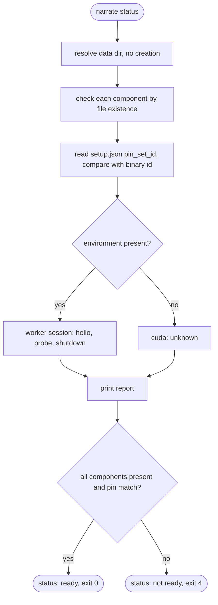

# spec-narrate-setup

## Metadata

| Field | Value |
|---|---|
| **Feature** | `narrate setup` and `narrate status`: pin set, source allow-list, pinned and verified downloads, reference clips, setup record, readiness check |
| **Parent feature** | spec-narrate-architecture.md |
| **Sub-features** | None |
| **Requirement refs** | BR-003, UR-003, UR-006, UR-010, FR-008, FR-010, FR-011, FR-012, FR-014, FR-015, FR-017, NFR-001, NFR-002, NFR-003, NFR-007, NFR-008 |
| **Feature type** | Functionality |
| **Status** | Review |

Status values: Draft, Review, Approved, Implemented.

Change Log 2026-10-13 (end of this file) modifies the source allow-list, lock-scanner rule 6, the `pyproject.toml` contents, step `environment`, and step `voices`. Where the change log and the body differ, the change log wins.

## Description

`narrate setup` builds the data directory from pins compiled into the binary: it refuses the wrong uv version, refuses any lockfile or pin entry outside the source allow-list or without a hash, installs CPython 3.11.14 and the locked environment with uv, downloads the Chatterbox-Turbo and Kokoro files at pinned commits and verifies their sha256 in Rust, renders the female, male, and builtin reference clips, and finally records the pin set identifier in `setup.json`. Each step skips work that is already complete and verified, so a re-run repairs a partial setup and a re-run on a complete setup makes no network request and leaves the clips byte-identical. `narrate status` and the generation readiness check read the same component definitions.

## Triggered by

| Trigger type | Source | Condition |
|---|---|---|
| User action | `narrate [--verbose] setup` | Any time; network needed only for missing artifacts |
| User action | `narrate [--verbose] status` | Any time; never creates or changes the data directory except, when `environment` is present, materializing the worker script (which stays) and creating the probe's per-run temporary directory `D\tmp\<run>`, which status removes afterwards together with `D\tmp` when that is left empty (Child process environment) |
| Called by feature | Generation readiness (spec-narrate-generation.md Requirement 4) | Every generation run |

## Required data

| Data | Source | Type | Notes |
|---|---|---|---|
| `pins.json` | `crates/narrate/pins.json`, embedded with `include_str!` (or `NARRATE_TEST_PINS_FILE` in test builds) | JSON | Schema below |
| `pyproject.toml` | `python/pyproject.toml`, embedded | TOML text | Exactly research P1 section 3.2 |
| `uv.lock` | `python/uv.lock`, embedded (or `NARRATE_TEST_LOCK_FILE` in test builds) | TOML text | Generated with uv 0.10.2; committed |
| Worker script | `python/narrate_worker.py`, embedded | Text | Not part of the pin set |
| uv | `NARRATE_UV` (test builds) or the first `uv.exe` found in the `PATH` directories, in order | Executable | Must report version 0.10.2 |

### Pin file schema (`crates/narrate/pins.json`)

```json
{
  "format": 1,
  "uv": { "version": "0.10.2" },
  "python": {
    "version": "3.11.14",
    "build": "cpython-3.11.14-windows-x86_64-none",
    "url": "https://github.com/astral-sh/python-build-standalone/releases/download/20260203/cpython-3.11.14%2B20260203-x86_64-pc-windows-msvc-install_only_stripped.tar.gz",
    "sha256": "851ba0c5a7c281912ca9bf68c340c69156e9e292de26f9068137f5650b537ff5"
  },
  "huggingface": [
    {
      "repo": "ResembleAI/chatterbox-turbo",
      "revision": "749d1c1a46eb10492095d68fbcf55691ccf137cd",
      "dir": "chatterbox-turbo",
      "files": [ { "path": "t3_turbo_v1.safetensors", "size": 1915480052, "sha256": "fcf1f8c1..." } ]
    },
    {
      "repo": "hexgrad/Kokoro-82M",
      "revision": "f3ff3571791e39611d31c381e3a41a3af07b4987",
      "dir": "kokoro-82m",
      "files": [ { "path": "voices/af_heart.pt", "size": 523425, "sha256": "0ab5709b..." } ]
    }
  ],
  "voices": {
    "reference_text": "<exact text below>",
    "min_samples": 240000,
    "female": { "engine": "kokoro", "voice": "af_heart" },
    "male": { "engine": "kokoro", "voice": "am_michael" },
    "builtin": { "engine": "chatterbox-turbo", "seed": 1 }
  }
}
```

The `files` arrays hold exactly the 13 rows of the pinned model file table below, each with its full sha256 and byte size, in the table's order. The schema example above shortens two hashes for layout only; `pins.json` uses the full values. `s3gen.safetensors` is not fetched (research F4).

#### Pinned model files

Copied exactly from `docs/research/phase1-python-runtime.md` lines 103 to 117 (research P1 section 2.1). "turbo" is repo `ResembleAI/chatterbox-turbo` (`dir` `chatterbox-turbo`) and "kokoro" is repo `hexgrad/Kokoro-82M` (`dir` `kokoro-82m`); the backticked name is the `files[].path` value.

| Repo file | Bytes | sha256 |
|---|---:|---|
| turbo `t3_turbo_v1.safetensors` | 1915480052 | `fcf1f8c1d651bb7e3acd69ee5be269b4ac10c02980b7708213d598bc9f7cdf87` |
| turbo `s3gen_meanflow.safetensors` | 1064875036 | `d65cb687a2ed581ee6cc297e919ffefa63386944f42364ae13b78a594945514f` |
| turbo `ve.safetensors` | 5695784 | `f0921cab452fa278bc25cd23ffd59d36f816d7dc5181dd1bef9751a7fb61f63c` |
| turbo `conds.pt` | 169454 | `b1852099306fd6a7814eb9d0bd10186caba7249596cc23868f78a0eefbfa5033` |
| turbo `vocab.json` | 999186 | `f6bd25a65e4e63ca31360e9fb11c7e4f9a391a78385d640acd814092dd6eee4f` |
| turbo `merges.txt` | 456318 | `1ce1664773c50f3e0cc8842619a93edc4624525b728b188a9e0be33b7726adc5` |
| turbo `tokenizer_config.json` | 3878 | `bca16a2ac1ddbd78b8d6228f0031884cc74b6ea54b967d6f6d2ebae9ccde23e6` |
| turbo `special_tokens_map.json` | 470 | `92ba8063bf40aa163eadebbfe0de07c2aebe44cf0d4a9e8726580b0781fd2640` |
| turbo `added_tokens.json` | 418 | `72e4ab6acb0d9309ac3df4b526ae5fd80a2da5bc5ab7bb02d85096a374f69193` |
| kokoro `kokoro-v1_0.pth` | 327212226 | `496dba118d1a58f5f3db2efc88dbdc216e0483fc89fe6e47ee1f2c53f18ad1e4` |
| kokoro `config.json` | 2351 | `5abb01e2403b072bf03d04fde160443e209d7a0dad49a423be15196b9b43c17f` |
| kokoro `voices/af_heart.pt` | 523425 | `0ab5709b8ffab19bfd849cd11d98f75b60af7733253ad0d67b12382a102cb4ff` |
| kokoro `voices/am_michael.pt` | 523435 | `9a443b79a4b22489a5b0ab7c651a0bcd1a30bef675c28333f06971abbd47bd37` |

The python-build-standalone `url` and `sha256` above were verified on this machine by the coordinator on 2026-10-12 with this procedure, which is also how any future change to them must be checked: (1) `uv python list 3.11.14 --only-downloads --show-urls` with uv 0.10.2 printed the URL for `cpython-3.11.14-windows-x86_64-none`; (2) the `cpython-3.11.14-windows-x86_64-none` entry of `crates/uv-python/download-metadata.json` at tag `0.10.2` of `astral-sh/uv` holds the same URL and sha256 `851ba0c5a7c281912ca9bf68c340c69156e9e292de26f9068137f5650b537ff5`; (3) the `SHA256SUMS` file of python-build-standalone release `20260203` lists the same sha256. All three sources must agree; on disagreement the developer stops and reports.

### Reference text for all three clips

`The morning light settled over the quiet harbor, and the fishing boats rocked gently against the pier. A gull called out twice, then glided low across the water. It will be a calm, clear day for a long walk along the coast.`

42 words, three sentences, no tags. At a typical 2.7 to 3.3 words per second this speaks for about 13 to 16 s (estimate), inside the 10 to 15 s range where every Turbo conditioning path is used (research P1 section 1.5).

### Developer procedure for step 3a (not runtime behavior)

These steps keep the lock reproducible and expose Kokoro or Turbo incompatibilities before the `voices` step is written. Kokoro is the risk: its run under transformers 5.2.0 is unverified (research P1 section 4), and kokoro retries `load_state_dict` with `strict=False`, which can yield bad clips instead of a `kokoro_failed` error.

1. Point every uv location at a development scratch directory `S` outside the repository and outside `%LOCALAPPDATA%\narrate`: `UV_CACHE_DIR=S\uv-cache`, `UV_PYTHON_INSTALL_DIR=S\python`, `UV_PYTHON_CACHE_DIR=S\python-cache`, `UV_PROJECT_ENVIRONMENT=S\venv`, `UV_NO_CONFIG=1`; run `uv python install 3.11.14 --no-bin --no-registry`.
2. Create the lock with a fixed resolution date so re-locking cannot drift past the researched versions: `uv lock --project python --exclude-newer 2026-10-13T00:00:00Z`. Fallback (unverified risk: the PyTorch index may publish no upload dates, and uv then excludes its files under `--exclude-newer`): if uv reports that `torch` or `torchaudio` files lack an upload date, or cannot resolve `torch` or `torchaudio` at all, run `uv lock --project python` without `--exclude-newer`, then do the key-pin check below, and report in the step 3a summary that the lock was made without `--exclude-newer` and why. In both cases check the key pins of research P1 section 3.2 (torch `2.6.0+cu124`, transformers 5.2.0, huggingface-hub 1.33.0, numpy 1.26.4, setuptools 81.0.0, resemble-perth 1.0.1, s3tokenizer 0.3.0); a difference is reported, not accepted silently. Commit `python/uv.lock`.
3. `uv sync --project python --frozen --managed-python --python 3.11.14` into `S\venv`, download the 13 pinned model files into `S` with the pinned revisions, then, with that venv, render one Kokoro `af_heart` clip of the reference text and one Turbo chunk with the builtin voice, using the same calls the worker spec prescribes (spec-narrate-worker.md Requirements 4 to 7). Run `qa/pitch/median_f0.py` (or the equivalent `librosa.pyin` settings) on the Kokoro clip: it must give at least 100 voiced frames and a median F0 of at least 165 Hz; inspect the Kokoro log for a `strict=False` retry warning. Any failure is reported before the `voices` step is written; the fallback (a separate Kokoro environment) needs a delta spec.

### Pin set identifier

`pin_set_id` = lowercase hex sha256 of the ASCII string `narrate-pin-set-v1\n` + sha256hex(`pins.json` bytes) + `\n` + sha256hex(`pyproject.toml` bytes) + `\n` + sha256hex(`uv.lock` bytes) + `\n`, using the effective files (test overrides included). Development and installed builds made from the same commit therefore share one id (FR-017).

### Source allow-list (hard-coded in Rust, never read from a file)

| Source (FR-011) | URL prefixes allowed in `uv.lock` and `pins.json` | Hosts contacted | Extra rule |
|---|---|---|---|
| PyPI through the lockfile | `https://pypi.org/simple`, `https://files.pythonhosted.org/packages/` | `pypi.org`, `files.pythonhosted.org` | |
| PyTorch explicit index | `https://download.pytorch.org/whl/` | `download.pytorch.org` | Only packages `torch` and `torchaudio` may come from it, and those two must come from it (research F3). Violations are `source-not-allowed` (exit 5) with the cause `<package> must come from https://download.pytorch.org/whl/ (the lock uses <url>)` when `torch` or `torchaudio` has another source, and `<package> may not come from https://download.pytorch.org/whl/` when any other package's source or artifact URL is under that prefix |
| spaCy English model (Kokoro G2P) | `https://github.com/explosion/spacy-models/releases/download/en_core_web_sm-3.8.0/` | `github.com`, then the release-asset redirect host | Wheel sha256 `1932429db727d4bff3deed6b34cfc05df17794f4a52eeb26cf8928f7c1a0fb85` (research P1 section 3.2) |
| uv-managed Python | `https://github.com/astral-sh/python-build-standalone/releases/download/` | `github.com`, then the release-asset redirect host | |
| Hugging Face repos at pinned commits | Repos `ResembleAI/chatterbox-turbo` and `hexgrad/Kokoro-82M` only, 40-hex revision | `huggingface.co`, then LFS redirect hosts | |
| espeak-ng | No separate source: bundled in the locked `espeakng-loader` 0.2.4 wheel (research P1 section 4) | none | |
| uv itself | Not downloaded by setup (FR-011) | none | |

Redirect hosts are expected, not researched: GitHub release assets redirect to `objects.githubusercontent.com` or `release-assets.githubusercontent.com`, and Hugging Face LFS files redirect to hosts ending in `.hf.co` or `.huggingface.co` (research phase 2 notes confirm a cross-host redirect without naming the host). The allow-list proxy used in QA permits exactly: `pypi.org`, `files.pythonhosted.org`, `download.pytorch.org`, `github.com`, `objects.githubusercontent.com`, `release-assets.githubusercontent.com`, `huggingface.co`, and any host ending in `.hf.co` or `.huggingface.co`. A request to any other host is a finding for the Owner; QA does not widen the list.

### Child process environment (NFR-002)

Every child (uv and worker) starts from the parent environment with every variable whose name starts, case-insensitively, with `UV_`, `HF_`, `HUGGINGFACE_`, `TRANSFORMERS_`, `PIP_`, `PYTHON`, `CONDA_`, `VIRTUAL_ENV`, or `NARRATE_TEST_` removed. Proxy variables, `PATH`, `CUDA_VISIBLE_DEVICES`, `FAKE_WORKER_*`, and `FAKE_UV_*` pass through. Then:

| Child | Variables set (`D` = data directory) |
|---|---|
| Every child except the preflight `uv --version` (uv steps after preflight, and every worker session, including the `status` probe) | `TEMP=D\tmp\<run>` and `TMP=D\tmp\<run>`, where `<run>` is `<narrate pid>-<start time in Unix milliseconds>`. `narrate` creates this directory only when `D` already exists and the first such child is about to start (in setup: after preflight has passed and created `D`; in generation: after the readiness check; in `status`: just before the probe, which runs only when `environment` is present). When the command ends it removes `D\tmp\<run>` (recursively, errors ignored) and then removes `D\tmp` itself if it is empty. The preflight `uv --version` child keeps the inherited `TEMP` and `TMP`, because `D` may not exist yet and preflight creates nothing. phonemizer, Kokoro's espeak fallback, copies the espeak DLL into `tempfile.mkdtemp()` and relies on `atexit` cleanup that `os._exit` and process termination skip, so without this redirection files would be left in the user's `%TEMP%` (NFR-002) |
| uv | `UV_CACHE_DIR=D\uv-cache`, `UV_PYTHON_INSTALL_DIR=D\python`, `UV_PYTHON_CACHE_DIR=D\python-cache`, `UV_PROJECT_ENVIRONMENT=D\venv`, `UV_NO_CONFIG=1` |
| uv `sync` only | also `UV_PYTHON_DOWNLOADS=never`, so `sync` can only use the Python that step `python` verified (uv documents this variable; it is not in the research notes) |
| Worker (all modes) | `HF_HOME=D\hf-home`, `HF_HUB_CACHE=D\hf-home\hub`, `HF_XET_CACHE=D\hf-home\xet`, `HF_ASSETS_CACHE=D\hf-home\assets`, `HF_HUB_DISABLE_TELEMETRY=1`, `DO_NOT_TRACK=1`, `HF_HUB_DISABLE_PROGRESS_BARS=1`, `HF_HUB_DISABLE_SYMLINKS_WARNING=1`, `HF_HUB_DISABLE_XET=1`, `TORCH_HOME=D\torch-home`, `NUMBA_CACHE_DIR=D\numba-cache`, `CUDA_CACHE_PATH=D\cuda-cache`, `MPLCONFIGDIR=D\mpl-config`, `TQDM_DISABLE=1` (research P1 section 8) |
| Worker except `download` sessions | also `HF_HUB_OFFLINE=1`, `TRANSFORMERS_OFFLINE=1` |
| Worker in test builds | also `NARRATE_TEST_FAIL_CHUNK`, `NARRATE_TEST_CRASH_CHUNK`, `NARRATE_TEST_WATERMARK_FAIL` when set in the parent |

`HF_HUB_DISABLE_XET`, `CUDA_CACHE_PATH`, and `MPLCONFIGDIR` are not in the research notes; they are harmless if unused and keep the Xet transfer client (whose proxy handling is unknown) and two possible caches out of the picture. uv commands always add `--no-bin --no-registry` to `uv python install` (research P1 section 3.3).

Stale temporary directories: in `setup` right after preflight passes, and in every generation right after the readiness check passes, `narrate` deletes each entry of `D\tmp\` whose last-write time is more than 24 hours old (recursively, errors ignored); it never creates `D\tmp` for this. The age limit, rather than clearing the whole directory, protects the temporary directory of a generation that is still running in another terminal.

Process creation (all children: uv and every worker session): `narrate` spawns each child with the creation flags `CREATE_NEW_PROCESS_GROUP | CREATE_NO_WINDOW` (`0x00000200 | 0x08000000`, through `std::os::windows::process::CommandExt::creation_flags`) and assigns it to the job object right after spawning. The child therefore has no console attached to `narrate`'s console and receives no `CTRL_C_EVENT` or `CTRL_BREAK_EVENT` from it; only `narrate` reacts to Ctrl+C and Ctrl+Break, and it stops the child itself (spec-narrate-generation.md Requirement 13, Requirement 9 below).

## Preconditions

| Condition | Check | If not met |
|---|---|---|
| uv present | `NARRATE_UV` or PATH search for `uv.exe` | `uv-not-found`, exit 5, nothing created |
| uv version 0.10.2 | First line of `uv --version`, second whitespace-separated token | `uv-version` with both versions, exit 5, nothing created |
| Pins and lock allowed and hashed | Allow-list scan (Requirement 1) | `source-not-allowed` or `pin-invalid`, exit 5, nothing created |
| Data directory writable | Create directory, then `setup.lock` | `data-dir-unwritable`, exit 5 |
| No other setup running | Exclusive `std::fs::File::try_lock` on `setup.lock` | `setup-busy`, exit 5 |

## Data flow

The setup flowchart is in spec-narrate-architecture.md (Setup data flow). Status:



## Algorithmic steps

Setup prints these progress lines to stderr (stdout stays empty for `setup`; spec-narrate-cli.md, Requirement: Stream discipline): `setup: data directory <D>` first, then one line per step `setup: [<k>/6] <step>: <result>` where `<result>` is `ok (uv 0.10.2)` for preflight, `ok (no network used)` or `ok (downloaded)` for `python`, `environment`, and `models`, `ok (all present)` or `ok (generated <comma-separated clip names>)` for `voices`, and `ok (pin set <first 12 hex of pin_set_id>)` for `record`; the last line is `setup: ready`. Each uv and worker output line from step `python` onward goes to `D\logs\setup-last.log` and, with `--verbose`, to stderr prefixed `uv: ` or `worker: `. `narrate` creates `D\logs\` and opens (truncating) `setup-last.log` only after preflight has passed, `D` exists, and the lock is held; the preflight `uv --version` output is parsed but never written to the log. With `--verbose`, setup also prints `verbose: uv pid <pid>` or `verbose: worker pid <pid>` to stderr for every child it starts (the preflight `uv --version` included), and the lines for children started after preflight also go to `setup-last.log`.

### Requirement 1: Preflight

Setup SHALL locate uv, require version 0.10.2 (running `uv --version` with the inherited `TEMP` and `TMP` and logging nothing), and validate the effective `pins.json` and `uv.lock` against the allow-list and hash rules before creating anything (no `D`, `D\tmp`, `D\logs`, or any other file or directory); only then SHALL it create the data directory, take the exclusive lock, open `D\logs\setup-last.log`, create `D\tmp\<run>`, write `project\pyproject.toml`, `project\uv.lock`, and `project\pins.json` (temp then rename, only when the content differs; together with `setup.json` they record the pin set in the data directory, FR-017), and delete `staging\voice-*.wav` files older than 1 hour (FR-010, FR-011).

Lock rules are enforced by a fail-closed line scanner over uv's lock layout; no TOML parser is used (none was researched). The scanner reads the effective `uv.lock` line by line (trailing whitespace and `\r` removed) and applies, in order:

1. Line shapes. After trimming leading whitespace, every line SHALL be one of: empty; a comment starting with `#`; a table header matching `^\[\[?[A-Za-z0-9_.-]+\]\]?$`; a key line matching `^[A-Za-z0-9_-]+ = .+$`; an array element starting with `{` or `"`; or a closing `]` or `],`. Any other line gives `pin-invalid` with cause `uv.lock line <n> has an unrecognized form`.
2. URLs everywhere. Every substring that starts with `https://`, `http://`, `git+`, `file:`, or `ssh://` and runs to the next `"` SHALL start with an allowed prefix and use `https`; otherwise `source-not-allowed` names it. This applies to every line, including `[package.metadata]` entries such as `index = ...` and `url = ...`.
3. Package blocks. A `[[package]]` header opens a block; the block's main part ends at the next table header of any kind. In the main part the scanner records `name = "<n>"`, `version = "<v>"`, and the `source = { ... }` line, which SHALL be exactly one of `{ registry = "<allowed prefix>..." }`, `{ url = "<allowed prefix>..." }`, or `{ virtual = "." }`; `virtual` is allowed only for `name = "narrate-worker"`; a `git`, `path`, `directory`, or `editable` key gives `source-not-allowed` with cause `<package> uses a <kind> source, which is not allowed`.
4. Artifacts. In a block's main part, every line other than the `source` line that contains `url = "` (the `sdist = { ... }` line and each element of a `wheels = [` array, whether on one line or several) SHALL also contain `hash = "sha256:<64 lowercase hex>"`; otherwise `pin-invalid` with cause `uv.lock line <n> (package <package>) has an artifact without a sha256 hash`.
5. Completeness. Every block SHALL have `name`, `version`, and `source`; every block whose source is `registry` or `url` SHALL have at least one hashed artifact; otherwise `pin-invalid` with cause `uv.lock package <package> is missing its <field>`, where `<package>` is the name (or `at line <n>` when the name is missing) and `<field>` is `name`, `version`, `source`, or `hashed artifact`.
6. PyTorch rule from the allow-list table (torch and torchaudio only, and always, from `https://download.pytorch.org/whl/`).

Pin rules (`pins.json`, parsed with `serde_json` into structs that reject unknown fields; any parse error, unknown field, or wrong type is `pin-invalid` with cause `pins.json is invalid: <serde_json error text>`): `format` 1; uv version `0.10.2`; Python `url` under the python-build-standalone prefix (else `source-not-allowed` with the URL) with a 64-hex `sha256`; only the repos `ResembleAI/chatterbox-turbo` and `hexgrad/Kokoro-82M` (another repo gives `source-not-allowed` with cause `Hugging Face repository <repo> is not allowed`), each with a 40-hex `revision`; every file with an integer `size` and a 64-hex `sha256`. A value that breaks one of these rules gives `pin-invalid` with cause `pins.json <field path> must be <expected>, found <value>` (for example `pins.json huggingface[0].revision must be 40 lowercase hex digits, found main`). Every `dir` and `files[].path` SHALL be relative, use `/` as the only separator, and contain no empty, `.`, or `..` segment, no `:` and no `\`, and SHALL NOT start with `/`; otherwise `pin-invalid` with cause `pins.json path <value> is not a safe relative path`. `narrate` builds every final and staging path from `D`, `dir`, and `path` itself, converting `/` to `\`.

#### Scenario: uv missing

- **GIVEN** a test build, `NARRATE_UV` unset, `PATH` set to an empty directory, and `NARRATE_DATA_DIR` set to an empty scratch directory
- **WHEN** the user runs `narrate setup`
- **THEN** the exit code SHALL be 5, stderr SHALL contain `error[uv-not-found]` and `0.10.2`
- **AND** the scratch directory SHALL stay empty

#### Scenario: uv version mismatch

- **GIVEN** a test build, `NARRATE_UV` naming the fake uv configured to print `uv 0.13.0 (test)`, and an empty scratch data directory
- **WHEN** the user runs `narrate setup`
- **THEN** the exit code SHALL be 5, stderr SHALL contain `error[uv-version]`, `0.13.0`, `0.10.2`, `uv-x86_64-pc-windows-msvc.zip`, `493ebbe0e06128d6ee4905e1ed5e2a433fb0f7cfc08b0eaca9fab4ca76778ae1`, and `install.ps1`, with the zip line before the `install.ps1` line
- **AND** the fake uv's log SHALL show only the `--version` invocation, and the scratch directory SHALL stay empty

#### Scenario: Disallowed source

- **GIVEN** a test build, the fake uv printing `uv 0.10.2 (test)`, and `NARRATE_TEST_LOCK_FILE` naming a copy of `python/uv.lock` in which one wheel URL is replaced by `https://evil.example.com/pkg-1.0-py3-none-any.whl`
- **WHEN** the user runs `narrate setup`
- **THEN** the exit code SHALL be 5, stderr SHALL contain `error[source-not-allowed]` and `https://evil.example.com/pkg-1.0-py3-none-any.whl`
- **AND** the fake uv's log SHALL show only the `--version` invocation

#### Scenario: Unhashed artifact

- **GIVEN** the same as above but one wheel entry has its `hash` field removed
- **WHEN** the user runs `narrate setup`
- **THEN** the exit code SHALL be 5 and stderr SHALL contain `error[pin-invalid]`

#### Scenario: Torch from the wrong index

- **GIVEN** a test build, the fake uv printing `uv 0.10.2 (test)`, and `NARRATE_TEST_LOCK_FILE` naming a lock copy in which `torch` has `source = { registry = "https://pypi.org/simple" }`
- **WHEN** the user runs `narrate setup`
- **THEN** the exit code SHALL be 5 and stderr SHALL contain the line `error[source-not-allowed]: torch must come from https://download.pytorch.org/whl/ (the lock uses https://pypi.org/simple)`

#### Scenario: Other package from the PyTorch index

- **GIVEN** the same, but `numpy` has `source = { registry = "https://download.pytorch.org/whl/cu124" }`
- **WHEN** the user runs `narrate setup`
- **THEN** the exit code SHALL be 5 and stderr SHALL contain `error[source-not-allowed]: numpy may not come from https://download.pytorch.org/whl/`

#### Scenario: Unrecognized lock line

- **GIVEN** the same, but a line `!!garbage` is inserted into a package block
- **WHEN** the user runs `narrate setup`
- **THEN** the exit code SHALL be 5 and stderr SHALL contain `error[pin-invalid]` and `has an unrecognized form`

#### Scenario: Unsafe pin path

- **GIVEN** a test build, the fake uv printing `uv 0.10.2 (test)`, and `NARRATE_TEST_PINS_FILE` naming a pins copy in which one `files[].path` is `../evil.bin`
- **WHEN** the user runs `narrate setup`
- **THEN** the exit code SHALL be 5, stderr SHALL contain `error[pin-invalid]` and `../evil.bin`, and the scratch data directory SHALL stay empty

#### Scenario: Setup already running

- **GIVEN** another process holds the lock on `D\setup.lock`
- **WHEN** the user runs `narrate setup`
- **THEN** the exit code SHALL be 5 and stderr SHALL contain `error[setup-busy]`

### Requirement 2: Step `python`

Setup SHALL first run `uv python install 3.11.14 --no-bin --no-registry --offline`, and accept it only when a file under `D\python-cache` has the pinned sha256; otherwise it SHALL delete `D\python` and `D\python-cache`, run the same command without `--offline`, and then require a file under `D\python-cache` whose sha256 equals `pins.python.sha256`, deleting both directories and failing with `hash-mismatch` naming the pinned URL when none matches (FR-011, NFR-001, NFR-002).

This relies on uv 0.10.2 keeping the downloaded archive in `UV_PYTHON_CACHE_DIR` (research P1 section 8 names the variable as the Python archive cache; retention was not tested). The developer confirms it in step 3a; if uv does not keep the archive, the developer stops and reports, and the fallback in spec-narrate-architecture.md (Design decisions, Python build verification) goes into a delta spec.

#### Scenario: Fresh install (GPU QA)

- **GIVEN** an empty scratch data directory and network access
- **WHEN** setup runs
- **THEN** the step line SHALL be `setup: [2/6] python: ok (downloaded)`
- **AND** `HKCU\Software\Python` and `%USERPROFILE%\.local\bin` SHALL be unchanged

#### Scenario: Already installed

- **GIVEN** a complete setup
- **WHEN** setup runs again with `HTTPS_PROXY=http://127.0.0.1:9`
- **THEN** the step line SHALL be `setup: [2/6] python: ok (no network used)`

#### Scenario: Python step with the fake uv (automated)

- **GIVEN** a test build, `NARRATE_UV` = fake uv, `NARRATE_WORKER_CMD` = fake worker, an empty scratch data directory, and `NARRATE_TEST_PINS_FILE` = a test pins file whose `python.sha256` is the sha256 of the archive fixture the fake uv copies into `UV_PYTHON_CACHE_DIR`
- **WHEN** setup runs twice
- **THEN** the first run SHALL print `setup: [2/6] python: ok (downloaded)` and the fake uv log SHALL show `python install` once with `--offline` and then once without it
- **AND** the second run SHALL print `setup: [2/6] python: ok (no network used)` and its `python install` invocation SHALL include `--offline`

#### Scenario: Archive hash mismatch (automated)

- **GIVEN** the same, but `python.sha256` in the test pins differs from the fixture's sha256
- **WHEN** setup runs
- **THEN** the exit code SHALL be 5, stderr SHALL contain `error[hash-mismatch]` and the pinned python URL, and `D\python` and `D\python-cache` SHALL NOT exist

### Requirement 3: Step `environment`

Setup SHALL run `uv sync --project D\project --frozen --managed-python --python 3.11.14 --no-progress --offline`, and on failure the same without `--offline`; on uv failure it SHALL report `hash-mismatch` (with uv's line) when uv's stderr contains `Hash mismatch`, else `setup-step-failed` at step `environment` with uv's last `error:` line; after success it SHALL require the `package` component (FR-010, NFR-001).

#### Scenario: Locked hash enforced (GPU QA)

- **GIVEN** a test build, an empty scratch data directory, and `NARRATE_TEST_LOCK_FILE` naming a lock copy in which one small wheel's sha256 is altered
- **WHEN** setup runs
- **THEN** the exit code SHALL be 5 and stderr SHALL contain `error[hash-mismatch]` and that package's name
- **AND** `narrate status` SHALL report not ready

#### Scenario: Re-run without network

- **GIVEN** a complete setup
- **WHEN** setup runs again with `HTTPS_PROXY=http://127.0.0.1:9`
- **THEN** the step line SHALL be `setup: [3/6] environment: ok (no network used)`

### Requirement 4: Step `models`

For every pinned file, setup SHALL keep the final file `D\models\<dir>\<path>` when its size and sha256 match the pin; for every other file it SHALL request `download` from a worker session (online environment) into `D\staging\models\<dir>`, require that the reply's `path` equals the staging path `narrate` computes for that file (`D\staging\models\<dir>\<path>`, compared after `std::path::absolute` and ASCII case folding; any other path fails the step with `setup-step-failed` and cause `the worker returned a path outside the staging directory: <path>`, and `narrate` deletes nothing at that path), verify size and sha256 in Rust, and on a match rename the file over the final path; on a mismatch it SHALL delete the staged file, leave any existing final file untouched, and fail with `hash-mismatch` naming `<repo>/<path>`; on `download_failed` it SHALL fail with `setup-step-failed` at step `models` naming the file and keep `D\staging\models\` so a re-run resumes; after all files verify it SHALL delete `D\staging\models\` (FR-010, FR-011, NFR-001, research F4, research P1 section 2.2).

#### Scenario: Pinned files fetched (GPU QA)

- **GIVEN** an empty scratch data directory after steps 1 to 3
- **WHEN** step `models` runs
- **THEN** all 13 files SHALL exist under `D\models\` with the pinned sha256 values, and `s3gen.safetensors` SHALL NOT exist

#### Scenario: Hash mismatch on a model file (GPU QA)

- **GIVEN** a test build and `NARRATE_TEST_PINS_FILE` naming a pins copy in which the sha256 of `added_tokens.json` is altered
- **WHEN** setup runs on a data directory that completed steps 1 to 3
- **THEN** the exit code SHALL be 5 and stderr SHALL contain `error[hash-mismatch]` and `ResembleAI/chatterbox-turbo/added_tokens.json`
- **AND** no file named `added_tokens.json` SHALL remain under `D\staging\`, and `setup.json` SHALL NOT be written by this run

#### Scenario: Model hash mismatch with the fake worker (automated)

- **GIVEN** a test build, the fake uv, the fake worker serving small fixture files for `download`, and test pins in which one file's `sha256` does not match the fixture the fake writes
- **WHEN** setup runs on an empty scratch data directory
- **THEN** the exit code SHALL be 5 and stderr SHALL contain `error[hash-mismatch]` and `<repo>/<path>` of that file
- **AND** no file with that name SHALL remain under `D\staging\`, and `D\setup.json` SHALL NOT exist

#### Scenario: Worker returns a path outside staging (automated)

- **GIVEN** the same, but the fake worker answers one `download` with a `path` outside `D\staging\models\`
- **WHEN** setup runs
- **THEN** the exit code SHALL be 5, stderr SHALL contain `error[setup-step-failed]` and `outside the staging directory`, and the file at that path SHALL still exist

#### Scenario: Network drop and resume (GPU QA)

- **GIVEN** `D\models\chatterbox-turbo\t3_turbo_v1.safetensors` is absent (deleted first if an earlier run placed it), and setup is running through the allow-list proxy, downloading that file
- **WHEN** the proxy is stopped
- **THEN** setup SHALL exit 5 with `error[setup-step-failed]`, `models`, and `t3_turbo_v1.safetensors`
- **AND** `narrate status` SHALL exit 4, and after restarting the proxy a re-run of `narrate setup` SHALL end with `setup: ready`

### Requirement 5: Step `voices`

For each clip in the order `female`, `male`, `builtin`, setup SHALL keep `D\voices\<name>.wav` when it exists and `D\setup.json` records the running binary's `pin_set_id`; otherwise it SHALL render the clip in one offline worker session (Kokoro `af_heart` and `am_michael` through `kokoro_clip`; builtin through `load` with device `auto`, `voice` `builtin`, and `synth` with `chunk` 1, `total` 1, `seed` 1), all with the reference text, SHALL re-render once with the reference text repeated twice (joined by one space) when the result has fewer than 240000 samples, SHALL fail with `setup-step-failed` at step `voices` if it is still shorter, and SHALL write each clip as a 24 kHz mono 16-bit WAV to `D\staging\clips\<name>.wav` and rename it into `D\voices\` (FR-010, FR-008).

#### Scenario: Clips created (GPU QA)

- **GIVEN** a data directory that completed steps 1 to 4
- **WHEN** step `voices` runs
- **THEN** `female.wav`, `male.wav`, and `builtin.wav` SHALL exist, each 24000 Hz, 1 channel, 16 bits, with at least 240000 samples (10 s)

#### Scenario: Re-run keeps clips byte-identical (GPU QA)

- **GIVEN** a complete setup and the sha256 of the three clips
- **WHEN** setup runs again
- **THEN** the step line SHALL be `setup: [5/6] voices: ok (all present)` and the three sha256 values SHALL be unchanged

#### Scenario: One clip deleted (automated with the fakes, and GPU QA)

- **GIVEN** a complete setup (real, or built by the fake uv and fake worker) with `male.wav` deleted
- **WHEN** setup runs again
- **THEN** the step line SHALL be `setup: [5/6] voices: ok (generated male)` and `female.wav` and `builtin.wav` SHALL be byte-identical to before

### Requirement 6: Step `record`

Setup SHALL write `D\setup.json` (temp then rename) only after steps 1 to 5 succeed, containing at least `format` 1 and `pin_set_id`, and also `narrate_version`, `completed_unix` (seconds since 1970-01-01 UTC), and `clips` with each clip's `sha256` and `samples` (FR-017).

```json
{"format":1,"pin_set_id":"<64 hex>","narrate_version":"0.1.0","completed_unix":1760300000,
 "clips":{"female":{"sha256":"<64 hex>","samples":312000},"male":{"sha256":"<64 hex>","samples":301000},"builtin":{"sha256":"<64 hex>","samples":330000}}}
```

#### Scenario: Record written last

- **GIVEN** setup fails in any step (automated: the fake worker answers `kokoro_clip` with `kokoro_failed` on a re-run over a complete fake setup whose `female.wav` was deleted)
- **WHEN** it exits
- **THEN** `setup.json` SHALL be byte-identical to before the run (absent, or the previous content)

#### Scenario: First run and re-run with the fakes (automated)

- **GIVEN** a test build, `NARRATE_UV` = fake uv, `NARRATE_WORKER_CMD` = fake worker, test pins whose 13 files are small fixtures the fake worker serves, and an empty scratch data directory, with every invocation in this scenario (both setup runs and the `narrate status` check) given the same `NARRATE_TEST_PINS_FILE`, `NARRATE_UV`, `NARRATE_WORKER_CMD`, and `NARRATE_DATA_DIR` (the pin set id depends on the effective `pins.json`, so a `status` run without the test pins file would report `pin set: mismatch`)
- **WHEN** setup runs, then runs again
- **THEN** the first run SHALL print `ok (downloaded)` for `python`, `environment`, and `models`, `ok (generated female, male, builtin)` for `voices`, end with `setup: ready`, and `narrate status` SHALL then exit 0
- **AND** the second run SHALL print `ok (no network used)` for `python`, `environment`, and `models` and `ok (all present)` for `voices`, the fake worker log SHALL contain no `download` or `kokoro_clip` request from it, and the three clips SHALL be byte-identical to the first run's

#### Scenario: Record matches binary

- **GIVEN** a successful setup
- **WHEN** `narrate status` runs with the same binary
- **THEN** the pin set line SHALL start with `pin set: match`

### Requirement 7: Readiness check

The system SHALL treat the data directory as ready only when every component below exists and `setup.json` parses with `format` 1 and a `pin_set_id` equal to the running binary's; it SHALL check existence only (hashes are verified during setup) and SHALL ignore unknown fields in `setup.json` (FR-014, FR-015, FR-017).

| Component (status label) | Files that must exist |
|---|---|
| `environment` | `D\venv\pyvenv.cfg`, `D\venv\Scripts\python.exe` |
| `package` | `D\venv\Lib\site-packages\chatterbox_tts-0.1.7.dist-info\METADATA` |
| `turbo weights` | `D\models\chatterbox-turbo\` + each of the 9 Turbo file names |
| `kokoro weights` | `D\models\kokoro-82m\kokoro-v1_0.pth`, `config.json`, `voices\af_heart.pt`, `voices\am_michael.pt` |
| `female clip`, `male clip`, `builtin clip` | `D\voices\female.wav`, `D\voices\male.wav`, `D\voices\builtin.wav` |
| `pin set` | `D\setup.json` with matching `pin_set_id` |

Generation reports the first failing category: any missing component gives `not-set-up` listing every missing component (for example `setup is incomplete: turbo weights missing (conds.pt), male clip missing`); a missing or unreadable `setup.json` gives `not-set-up` with `setup record missing`; a different `pin_set_id` gives `pin-mismatch`.

#### Scenario: Fabricated directory is ready

- **GIVEN** a scratch directory containing every file in the table (empty files allowed) and `setup.json` = `{"format":1,"pin_set_id":"<binary id>"}`
- **WHEN** the user runs `narrate status` with the fake worker
- **THEN** stdout SHALL end with `status: ready` and the exit code SHALL be 0

#### Scenario: Dev build reuses setup (FR-017)

- **GIVEN** a data directory set up by the installed binary
- **WHEN** a development build of the same commit runs `narrate status`
- **THEN** it SHALL report `status: ready` without running setup

### Requirement 8: Status report

`narrate status` SHALL print to stdout, in this order, exactly these lines (`<id>` is a full 64-hex pin set id) and SHALL exit 0 when ready and 4 otherwise, without creating the data directory (FR-014, FR-017):

```text
<version line, as narrate --version>
data directory: <D>
environment: present | missing
package: present (chatterbox-tts 0.1.7) | missing | wrong version (chatterbox-tts <v>, expected 0.1.7)
turbo weights: present | missing (<missing file names, comma-separated>)
kokoro weights: present | missing (<missing file names, comma-separated>)
female clip: present | missing
male clip: present | missing
builtin clip: present | missing
pin set: match (binary <id>, recorded <id>) | mismatch (binary <id>, recorded <id>) | missing (binary <id>, recorded none)
cuda: available (<device name>, torch <version>) | not available (torch <version>) | unknown (environment missing) | unknown (probe failed)
status: ready | not ready (run narrate setup)
```

The `cuda` line comes from a worker session (`hello`, `probe`, `shutdown`; 60 s limit for `hello`, 120 s for `probe`) started only when `environment` is present; it never affects readiness. The probe worker's stderr is discarded, or shown as `worker: ` lines on stderr with `--verbose`; status writes no log file.

#### Scenario: Ready

- **GIVEN** a complete setup
- **WHEN** the user runs `narrate status`
- **THEN** every component line SHALL say `present`, the pin line SHALL start with `pin set: match`, a `cuda:` line SHALL be present, and the exit code SHALL be 0

#### Scenario: Not ready (weights missing)

- **GIVEN** a fabricated ready directory with `models\chatterbox-turbo\t3_turbo_v1.safetensors` deleted
- **WHEN** the user runs `narrate status`
- **THEN** stdout SHALL contain `turbo weights: missing (t3_turbo_v1.safetensors)` and `status: not ready (run narrate setup)`, and the exit code SHALL be 4

#### Scenario: Empty scratch directory (FR-017 override)

- **GIVEN** `NARRATE_DATA_DIR` names an empty scratch directory
- **WHEN** the user runs `narrate status`
- **THEN** stdout SHALL contain `environment: missing`, `cuda: unknown (environment missing)`, a line matching `^pin set: missing \(binary [0-9a-f]{64}, recorded none\)$`, and `status: not ready (run narrate setup)`
- **AND** the exit code SHALL be 4 and the scratch directory SHALL still be empty

#### Scenario: Pin-set mismatch (FR-017)

- **GIVEN** a fabricated ready directory whose `setup.json` has a different `pin_set_id`
- **WHEN** the user runs `narrate status`
- **THEN** stdout SHALL contain `pin set: mismatch (binary ` and `status: not ready (run narrate setup)`, and the exit code SHALL be 4

#### Scenario: CUDA reported from the worker

- **GIVEN** a fabricated ready directory and a fake worker whose `probe` reply is `cuda_available: true`, `device_name: "Fake GPU"`, `torch: "2.6.0+cu124"`
- **WHEN** the user runs `narrate status`
- **THEN** stdout SHALL contain `cuda: available (Fake GPU, torch 2.6.0+cu124)`

### Requirement 9: Setup interruption

When Ctrl+C or Ctrl+Break arrives during setup, the system SHALL terminate its child process (uv or worker, spawned in its own process group without a console and assigned to the job object, see Child process environment), keep completed steps and `D\staging\models\`, release the lock, and exit 130 with `error[setup-interrupted]`. When a child exits unexpectedly, setup SHALL wait up to 500 ms for a pending interrupt before reporting the step failure, and SHALL report `setup-interrupted` if the interrupt flag is set within that window (the same rule as generation RULE-006).

#### Scenario: Interrupted download (GPU QA)

- **GIVEN** setup downloading model files, started in a new process group
- **WHEN** Ctrl+Break is sent to setup's process group with `narrate-test-signal`
- **THEN** setup SHALL exit 130 within 10 s with `error[setup-interrupted]`
- **AND** `narrate-test-signal alive <pid>` SHALL exit 1 for every pid on the `verbose: uv pid` and `verbose: worker pid` lines of that run (setup run with `--verbose`)

#### Scenario: Interrupted environment step (automated)

- **GIVEN** a test build, the fake uv configured to sleep 30 s inside `sync`, and setup started in a new process group
- **WHEN** the test sends Ctrl+Break to that group once the fake uv log shows a `sync` invocation
- **THEN** setup SHALL exit 130 with `error[setup-interrupted]` within 10 s, and `setup.json` SHALL NOT exist

## Business rules

| Rule ID | Rule | Traces to | Applied at step | Example |
|---|---|---|---|---|
| RULE-001 | Allow-list and hash checks run before any directory is created or any download starts | FR-011 | Requirement 1 | |
| RULE-002 | Files reach final paths only after sha256 verification (temp then rename) | FR-010, NFR-001 | Requirements 2, 4, 5, 6 | |
| RULE-003 | `--offline` first for uv steps, network only when needed | FR-010 | Requirements 2, 3 | Re-run makes no request |
| RULE-004 | Never delete data-directory entries setup does not own (`onnx\`, unknown files) | UR-010 | All | Phase 2 data in `onnx\` survives a Phase 1 setup |
| RULE-005 | Clips are re-rendered only when missing or when the record's pin set differs | FR-010 | Requirement 5 | Byte-identical re-run |
| RULE-006 | Setup never downloads uv | FR-011 | Requirement 1 | |

## Data transformations

| Input | Transformation | Output | Notes |
|---|---|---|---|
| Embedded files | sha256 composition | `pin_set_id` | Pin set identifier |
| Downloaded bytes | sha256 and size compare | Verified file or `hash-mismatch` | |
| Worker samples | `f32_to_pcm16`, WAV header | Clip WAV | Same encoder as generation |

## Output / Outcome

| Output | Type | Description |
|---|---|---|
| Data directory | Files | Layout in spec-narrate-architecture.md |
| `setup.json` | File | Requirement 6 |
| Status report | stdout | Requirement 8 |
| `logs\setup-last.log` | File | uv and worker output of the last setup |

## Error handling

| Error condition | Handling strategy | Outcome |
|---|---|---|
| uv missing or wrong version | Stop in preflight | Exit 5; install command printed; nothing created |
| Lock or pin violates the allow-list or lacks a hash | Stop in preflight | Exit 5 naming the URL or artifact |
| uv command fails | Relay uv's error line; keep completed steps | Exit 5 (`hash-mismatch` or `setup-step-failed`) |
| Download fails | Keep staging for resume | Exit 5 naming `models` and the file |
| Hash mismatch | Delete the downloaded file | Exit 5 naming the file |
| Clip too short twice | Stop | Exit 5 naming `voices` and the clip |
| Interrupt | Kill child, keep progress | Exit 130 |
| Probe fails in status | Report `cuda: unknown (probe failed)` | Readiness unaffected |

## Events emitted

| Event name | Payload | Consumer(s) | When emitted |
|---|---|---|---|
| Worker requests `download`, `kokoro_clip`, `load`, `voice`, `synth`, `probe` | spec-narrate-worker.md | Worker | Requirements 4, 5, 8 |

## Events consumed

| Event name | Producer | Payload used | Handling |
|---|---|---|---|
| Worker responses | Worker | `path`, samples, `cuda_available`, `device_name`, `torch` | Requirements 4, 5, 8 |

## Sub-feature breakdown

Not applicable.

## Performance considerations

| Concern | Target | Approach |
|---|---|---|
| First setup download | About 6.2 GB (estimate, research P1 section 3.4) | Single pass; `s3gen.safetensors` skipped saves 1.06 GB |
| Re-run time | Dominated by hashing about 3.3 GB of model files (estimate under 30 s) | sha256 in Rust; no network |
| `status` time | A few seconds for the torch import in `probe` (unverified) | Existence checks only |

## Traceability

| Requirement | Spec section | Verified by |
|---|---|---|
| BR-003, UR-010 | Source allow-list; Requirements 1 to 4 | CLI tests `crates/narrate/tests/setup_preflight.rs`; GPU QA proxy run |
| UR-003 | Requirements 1 to 6 | GPU QA real setup |
| UR-006 | Requirement 8; Error handling | `crates/narrate/tests/status.rs` |
| FR-008 | Requirement 7 (conds.pt) | `crates/narrate/tests/voices.rs` |
| FR-010 | Requirements 1 to 6, 9 | `setup_preflight.rs` (uv missing); `crates/narrate/tests/setup_steps.rs` (first run, re-run lines, deleted clip, record written last, interrupted `sync`); GPU QA (first setup, re-run, network drop) |
| FR-011 | Requirement 1 (lock scanner, pin rules, PyTorch rule); Source allow-list; Pin file schema | `setup_preflight.rs`; `crates/narrate/tests/pins.rs` (repository inspection); GPU QA proxy run |
| FR-012 | Requirement 7; Child process environment | `status.rs`; GPU QA offline run |
| FR-014 | Requirement 8 | `status.rs` |
| FR-015 | Requirement 7 | `crates/narrate/tests/status.rs` |
| FR-017 | Pin set identifier; Requirements 6, 7, 8 | `status.rs`; GPU QA dev-build reuse |
| NFR-001 | Requirements 2, 3, 4 | `setup_steps.rs` (archive and model hash mismatch with fakes); GPU QA altered lock and altered pins runs |
| NFR-002 | Child process environment (including `TEMP`/`TMP`); Requirement 2 | `chunks.rs` and `setup_steps.rs` (child environment dumps show `TEMP` and `TMP` under `D\tmp\`); GPU QA snapshot (`qa/nfr002/snapshot.ps1`) |
| NFR-003 | All steps run as the current user | GPU QA as a standard user |
| NFR-007, NFR-008 | Error handling | All setup and status tests |
| FR-011, BR-003 (2026-10-13) | Change Log 2026-10-13: PyTorch row and redirect hosts; lock-scanner rule 6 | `setup_preflight.rs` (R2 wheel accepted, other package on R2 rejected, project metadata ignored); GPU QA proxy run |
| FR-010, FR-011, NFR-001 (2026-10-13) | Change Log 2026-10-13: `pyproject.toml` row; Requirement 3 (two-phase sync) | `setup_steps.rs` (sync phase arguments); GPU QA item 14 |
| FR-010 (2026-10-13) | Change Log 2026-10-13: Requirement 5 (Kokoro on CPU, builtin load retried on CPU) | `setup_steps.rs` (Kokoro device, out-of-memory retry) |

## Change Log: 2026-10-13

**Source:** User decisions in `DECISIONS.md` dated 2026-10-13 ("PyTorch wheel host"; "Build backend for source-only packages"), which apply FR-011, NFR-001, and BR-003; and implementation findings from plan step 3a against FR-010 (Kokoro device, builtin clip on low VRAM) and FR-011 (lock-scanner rule 6 scope). `docs/requirements.md` is unchanged.

**Correction to the research notes:** research P1 sections 3.2 and 3.4 report no sdist-only dependency for CPython 3.11 on Windows. The lock committed in step 3a contains `docopt` 0.6.2, which has only an sdist (`python/uv.lock` lines 357 to 360; needed by `num2words` through `misaki[en]`), so `uv sync` must build it. This spec no longer relies on the research claim; the MODIFIED Requirement 3 below covers the build.

### ADDED Requirements

None. Every change below modifies an existing section.

### MODIFIED Requirements

#### Requirement: Source allow-list, PyTorch row and redirect hosts

**Was:** PyTorch row: prefix `https://download.pytorch.org/whl/`, host `download.pytorch.org`, "Only packages `torch` and `torchaudio` may come from it, and those two must come from it (research F3)", with the causes `<package> must come from https://download.pytorch.org/whl/ (the lock uses <url>)` and `<package> may not come from https://download.pytorch.org/whl/`. QA proxy list: "`pypi.org`, `files.pythonhosted.org`, `download.pytorch.org`, `github.com`, `objects.githubusercontent.com`, `release-assets.githubusercontent.com`, `huggingface.co`, and any host ending in `.hf.co` or `.huggingface.co`".
**Now:** The PyTorch source has two URL prefixes: `https://download.pytorch.org/whl/` (index and artifacts) and `https://download-r2.pytorch.org/whl/` (artifacts only, because the official index at `https://download.pytorch.org/whl/cu124` lists its wheel files under `https://download-r2.pytorch.org/whl/cu124/`). Hosts contacted: `download.pytorch.org` and `download-r2.pytorch.org`. `torch` and `torchaudio` SHALL have a `registry` source starting with `https://download.pytorch.org/whl/`, and each of their artifact URLs SHALL start with one of the two prefixes; no other package's source or artifact URL may start with either prefix. `uv.lock` stays exactly as uv writes it, and every sha256 check applies unchanged. Causes (all `source-not-allowed`, exit 5): `<package> must come from https://download.pytorch.org/whl/ (the lock uses <url>)` when `torch` or `torchaudio` has another source or an artifact URL outside both prefixes; `<package> may not come from <prefix>` when any other package's source or artifact URL starts with `<prefix>`, where `<prefix>` is whichever of `https://download.pytorch.org/whl/` or `https://download-r2.pytorch.org/whl/` matched. The QA allow-list proxy permits exactly: `pypi.org`, `files.pythonhosted.org`, `download.pytorch.org`, `download-r2.pytorch.org`, `github.com`, `objects.githubusercontent.com`, `release-assets.githubusercontent.com`, `huggingface.co`, and any host ending in `.hf.co` or `.huggingface.co`. The proxy checks hosts only; the torch-and-torchaudio-only restriction is enforced by lock-scanner rule 6.
**Reason:** User decision 2026-10-13, "PyTorch wheel host".

##### Scenario: Torch wheel on the R2 host accepted

- **GIVEN** a test build, the fake uv printing `uv 0.10.2 (test)`, an empty scratch data directory, and `NARRATE_TEST_LOCK_FILE` naming a copy of `python/uv.lock` in which the `torch` wheel URL prefix `https://download.pytorch.org/whl/cu124/` is replaced by `https://download-r2.pytorch.org/whl/cu124/` (hash unchanged)
- **WHEN** the user runs `narrate setup`
- **THEN** stderr SHALL contain `setup: [1/6] preflight: ok (uv 0.10.2)`
- **AND** stderr SHALL NOT contain `error[source-not-allowed]` or `error[pin-invalid]` (later steps may fail with the fake uv; only preflight is under test)

##### Scenario: Other package on the R2 host

- **GIVEN** the same, but the copy moves a `numpy` wheel URL to `https://download-r2.pytorch.org/whl/cu124/` instead
- **WHEN** the user runs `narrate setup`
- **THEN** the exit code SHALL be 5 and stderr SHALL contain `error[source-not-allowed]: numpy may not come from https://download-r2.pytorch.org/whl/`

#### Requirement: Lock-scanner rule 6 scope (Requirement 1)

**Was:** "6. PyTorch rule from the allow-list table (torch and torchaudio only, and always, from `https://download.pytorch.org/whl/`)."
**Now:** "6. PyTorch rule. For each `[[package]]` block, the scanner applies the PyTorch rule of the allow-list table only to the block's main part, and there only to its `source` line and its artifact lines (the `sdist` line and every element of `wheels`). Lines under `[package.metadata]`, `[package.optional-dependencies]`, or any other subtable are never inspected by this rule; rule 2 still checks every URL in them against the allow-list prefixes."
**Reason:** Clarification from step 3a: the project's own block (`narrate-worker`) names the PyTorch index in `[package.metadata]` (`index = "https://download.pytorch.org/whl/cu124"`, `python/uv.lock` lines 856 and 857). That line records which index the project told uv to use, and must not trigger `<package> may not come from ...`.

##### Scenario: Index named in project metadata is ignored by rule 6

- **GIVEN** a test build, the fake uv printing `uv 0.10.2 (test)`, and the committed `python/uv.lock` (no lock override)
- **WHEN** the user runs `narrate setup`
- **THEN** stderr SHALL contain `setup: [1/6] preflight: ok (uv 0.10.2)` and SHALL NOT contain `narrate-worker may not come from`

#### Requirement: `pyproject.toml` contents (Required data)

**Was:** "| `pyproject.toml` | `python/pyproject.toml`, embedded | TOML text | Exactly research P1 section 3.2 |"
**Now:** `python/pyproject.toml` is research P1 section 3.2 plus exactly two keys under `[tool.uv]`: `no-build-isolation-package = ["docopt"]` and `build-constraint-dependencies = ["setuptools==81.0.0"]`. Nothing else changes. `python/uv.lock` is regenerated with uv 0.10.2 after this change, and `uv lock --check --project python` passes. Both files stay embedded and part of the pin set, so the pin set id changes once.
**Reason:** User decision 2026-10-13, "Build backend for source-only packages".

##### Scenario: Build keys present

- **GIVEN** the repository source
- **WHEN** `crates/narrate/tests/pins.rs` reads `python/pyproject.toml`
- **THEN** `[tool.uv]` SHALL contain `no-build-isolation-package = ["docopt"]` and `build-constraint-dependencies = ["setuptools==81.0.0"]`

#### Requirement 3: Step `environment`

**Was:** "Setup SHALL run `uv sync --project D\project --frozen --managed-python --python 3.11.14 --no-progress --offline`, and on failure the same without `--offline`; on uv failure it SHALL report `hash-mismatch` (with uv's line) when uv's stderr contains `Hash mismatch`, else `setup-step-failed` at step `environment` with uv's last `error:` line; after success it SHALL require the `package` component (FR-010, NFR-001)."
**Now:** Setup SHALL sync in two phases, each run first with `--offline` and, on failure, again without it:

- Phase A (wheels only): `uv sync --project D\project --frozen --managed-python --python 3.11.14 --no-progress --no-build --no-install-package docopt`. `--no-build` makes uv refuse to build any package, so a lock entry other than `docopt` that would need a build fails the step (fail closed) instead of fetching build dependencies.
- Phase B (`docopt` only): `uv sync --project D\project --frozen --managed-python --python 3.11.14 --no-progress --no-build-isolation-package docopt`. Phase A already installed every other package, so phase B installs only `docopt`: uv downloads its hash-locked sdist and builds it without build isolation, using the `setuptools` 81.0.0 that phase A installed from the lock with its sha256 checked. No build environment is created, so no build dependency is fetched.

The step result is `ok (no network used)` only when both phases succeeded with `--offline`, else `ok (downloaded)`. Error mapping is unchanged: `hash-mismatch` when uv's stderr contains `Hash mismatch`, else `setup-step-failed` at step `environment` with uv's last `error:` line (for a phase A refusal, that line names the package uv would have built). After phase B, setup SHALL require the `package` component.

Developer verification with uv 0.10.2 (plan step 3a, before this step ships): (1) `uv sync` 0.10.2 accepts both argument sets; (2) on a scratch data directory, phase B run by hand with `-v` builds `docopt` without creating a build environment and downloads nothing but `docopt-0.6.2.tar.gz`; (3) after a full setup, every directory named `setuptools-*.dist-info` under `D\uv-cache` is `setuptools-81.0.0.dist-info`.

Fallback, if uv 0.10.2 rejects the flags or still creates an isolated build environment for `docopt`: keep build isolation but constrain it. Add `python/build-constraints.txt` with the single line `setuptools==81.0.0 --hash=sha256:<sha256 of the setuptools 81.0.0 wheel as recorded in uv.lock>`, embed it like `uv.lock`, write it to `D\project\build-constraints.txt`, pass it to both phases with `--build-constraint D\project\build-constraints.txt`, and add its sha256 to the pin set id as a fourth line after `uv.lock`. Then confirm on a scratch run that uv 0.10.2 fails when that hash is altered. If uv cannot enforce that hash either, the developer stops and reports, and setup does not ship a build path that fetches an unhashed build dependency (the Owner decides).
**Reason:** User decision 2026-10-13, "Build backend for source-only packages": in step 3a, `uv sync` built `docopt` in an isolated build environment and fetched an unpinned `setuptools` for it.

##### Scenario: Two sync phases in order (automated)

- **GIVEN** a test build, the fake uv logging its arguments, the fake worker, test pins, and an empty scratch data directory
- **WHEN** setup runs
- **THEN** the fake uv log SHALL show, after `python install`, `sync` invocations whose arguments contain, in order: `--no-build`, `--no-install-package docopt`, and `--offline`; then `--no-build` and `--no-install-package docopt` without `--offline`; then `--no-build-isolation-package docopt` with `--offline`
- **AND** no `sync` invocation SHALL contain both `--no-build` and `--no-build-isolation-package`
- **AND** setup SHALL end with `setup: ready`

##### Scenario: Only the locked setuptools builds docopt (GPU QA)

- **GIVEN** an empty scratch data directory and setup run through the allow-list proxy
- **WHEN** step `environment` completes
- **THEN** `D\venv\Lib\site-packages` SHALL contain a `docopt` distribution
- **AND** every directory named `setuptools-*.dist-info` under `D\uv-cache` SHALL be `setuptools-81.0.0.dist-info`

#### Requirement 5: Step `voices`

**Was:** "...otherwise it SHALL render the clip in one offline worker session (Kokoro `af_heart` and `am_michael` through `kokoro_clip`; builtin through `load` with device `auto`, `voice` `builtin`, and `synth` with `chunk` 1, `total` 1, `seed` 1), all with the reference text, ..."
**Now:** Every other part of Requirement 5 is unchanged, with two differences:
1. Setup sends every `kokoro_clip` request with `device` `"cpu"`. Each clip takes about 10 to 15 s on CPU (measured in step 3a).
2. For the builtin clip, setup sends `load` with device `auto`. If that `load` is answered with `out_of_memory`, setup SHALL print exactly `setup: the GPU has too little free memory for the model; rendering the builtin clip on the CPU` to stderr (also written to `setup-last.log`), send `load` again with device `cpu` in the same worker session, and continue with `voice` and `synth`. Any error from that second `load` fails the step with `setup-step-failed` at step `voices`. Only `out_of_memory` triggers the retry.
**Reason:** Step 3a findings. On CUDA, Kokoro stalled in `torch.istft` after `torch.cuda.empty_cache()`, and one first-ever Kokoro CUDA call never completed. Other programs can hold most of the 8 GB of VRAM (research F8), so a CPU render of the short Kokoro clips is reliable and independent of free VRAM. The builtin-clip retry is accepted as implemented.

##### Scenario: Kokoro clips rendered on the CPU (automated)

- **GIVEN** a test build, the fakes, test pins, and an empty scratch data directory
- **WHEN** setup runs
- **THEN** every `kokoro_clip` request in the fake worker log SHALL have `"device": "cpu"`

##### Scenario: Builtin load retried on the CPU after out of memory (automated)

- **GIVEN** the same, but the fake worker answers the first `load` of the session with error code `out_of_memory` and later `load` requests normally
- **WHEN** setup runs
- **THEN** stderr SHALL contain the line `setup: the GPU has too little free memory for the model; rendering the builtin clip on the CPU`
- **AND** the fake worker log SHALL show a second `load` request with `"device": "cpu"`, and setup SHALL end with `setup: ready`

##### Scenario: CPU load also fails (automated)

- **GIVEN** the same, but the fake worker answers every `load` with `out_of_memory`
- **WHEN** setup runs
- **THEN** the exit code SHALL be 5 and stderr SHALL contain `error[setup-step-failed]: setup failed at step voices: `

### REMOVED Requirements

None.
