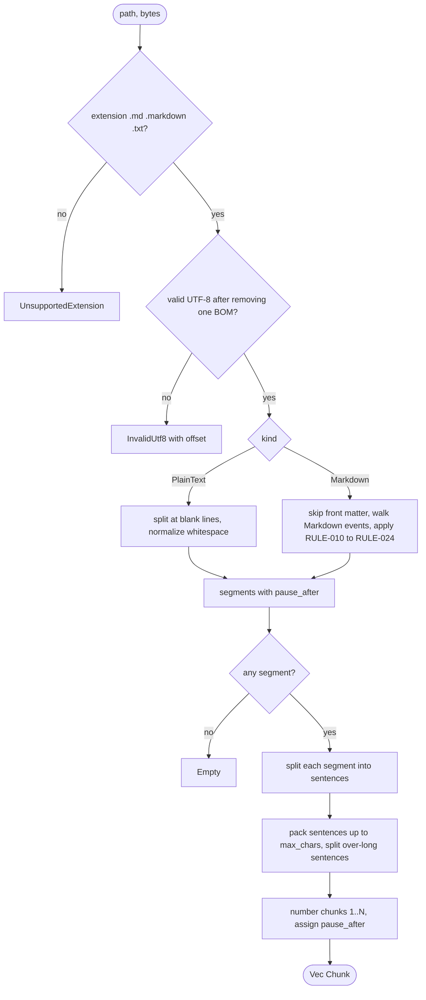

# spec-narrate-text-pipeline

## Metadata

| Field | Value |
|---|---|
| **Feature** | Script decoding, Markdown-to-speech conversion, paralinguistic tags, sentence chunking, and pause plan (`narrate_core` library) |
| **Parent feature** | spec-narrate-architecture.md |
| **Sub-features** | None |
| **Requirement refs** | UR-001, FR-001, FR-002, FR-003, FR-004, FR-005 |
| **Feature type** | Functionality |
| **Status** | Draft |

Status values: Draft, Review, Approved, Implemented.

## Description

The `narrate_core` library turns script bytes into an ordered list of speakable segments, each carrying the pause that follows it, and then packs segments into model-sized chunks at sentence boundaries. It runs without the model, which satisfies FR-005's "run the chunker without the model", and its public API is the target of black-box library tests in `crates/narrate-core/tests/`. The rules below are complete: two implementations that follow them produce the same segments and chunks for the same input.

## Triggered by

| Trigger type | Source | Condition |
|---|---|---|
| Called by feature | Generation (spec-narrate-generation.md) | After the readiness check passes |
| Called by test | `crates/narrate-core/tests/*.rs` | Any time; no model, data directory, or network needed |

## Required data

| Data | Source | Type | Notes |
|---|---|---|---|
| Script path | CLI `<FILE>` | `&Path` | Extension decides the kind |
| Script bytes | File system | `&[u8]` | UTF-8, optional leading BOM `EF BB BF` |
| `max_chars` | Caller | `usize` | Generation always passes `MAX_CHUNK_CHARS` = 300; must be >= 1 |

## Preconditions

| Condition | Check | If not met |
|---|---|---|
| Extension is `.md`, `.markdown`, or `.txt` (ASCII case-insensitive) | `ScriptKind::from_path` | `ScriptError::UnsupportedExtension` |
| Path exists and is a file | `std::fs::metadata` | `ScriptError::NotFound` or `ScriptError::NotAFile` |
| Bytes are valid UTF-8 | `decode_utf8` | `ScriptError::InvalidUtf8` with the byte offset of the first invalid byte, counted from the start of the file |

## Public API

Crate `narrate_core` (package `narrate-core`). Every public item of the six modules `script`, `spoken`, `chunk`, `tags`, `audio`, and `clip` is reachable at its module path and is also re-exported at the crate root (`narrate_core::Chunk`, `narrate_core::ClipInfo`, `narrate_core::f32_to_pcm16`, and so on); the items of `audio` and `clip` are listed in spec-narrate-generation.md. Error enums implement `std::fmt::Debug`, `std::fmt::Display`, and `std::error::Error`. Derives are binding as written. `ScriptError` derives only `Debug`: it cannot implement `PartialEq` or `Clone` because its `Io` variant holds a `std::io::Error`, so tests check it with `matches!` (for example `matches!(err, ScriptError::InvalidUtf8 { offset: 2, .. })`). Signatures are binding; private helpers are free.

| Module path | Item | Signature or definition |
|---|---|---|
| `narrate_core::script` | `ScriptKind` | `#[derive(Debug, Clone, Copy, PartialEq, Eq)] pub enum ScriptKind { Markdown, PlainText }` |
| `narrate_core::script` | `ScriptKind::from_path` | `pub fn from_path(path: &Path) -> Result<ScriptKind, ScriptError>`: `.md` and `.markdown` give `Markdown`, `.txt` gives `PlainText`; checks only the extension |
| `narrate_core::script` | `ScriptError` | `#[derive(Debug)] pub enum ScriptError { UnsupportedExtension { path: PathBuf }, NotFound { path: PathBuf }, NotAFile { path: PathBuf }, Io { path: PathBuf, source: std::io::Error }, InvalidUtf8 { path: PathBuf, offset: usize }, Empty { path: PathBuf } }` |
| `narrate_core::script` | `decode_utf8` | `pub fn decode_utf8(path: &Path, bytes: &[u8]) -> Result<String, ScriptError>`: removes one leading U+FEFF, then validates |
| `narrate_core::script` | `load_script` | `pub fn load_script(path: &Path) -> Result<SpokenScript, ScriptError>`: `from_path`, then existence and file check, read, `decode_utf8`, `to_spoken`, and `Empty` when the result has no segments |
| `narrate_core::spoken` | `Pause` | `#[derive(Debug, Clone, Copy, PartialEq, Eq, Hash)] pub enum Pause { Chunk, Cell, Paragraph, Heading }` |
| `narrate_core::spoken` | `Pause::samples` | `pub const fn samples(self) -> u32`: `Chunk` 4800, `Cell` 7200, `Paragraph` 12000, `Heading` 19200 |
| `narrate_core::spoken` | `Segment` | `#[derive(Debug, Clone, PartialEq, Eq)] pub struct Segment { pub text: String, pub pause_after: Pause }` |
| `narrate_core::spoken` | `SpokenScript` | `#[derive(Debug, Clone, PartialEq, Eq, Default)] pub struct SpokenScript { pub segments: Vec<Segment> }` |
| `narrate_core::spoken` | `SpokenScript::is_empty` | `pub fn is_empty(&self) -> bool`: true when `segments` is empty |
| `narrate_core::spoken` | `SpokenScript::spoken_text` | `pub fn spoken_text(&self) -> String`: segment texts joined with `"\n\n"` |
| `narrate_core::spoken` | `to_spoken` | `pub fn to_spoken(text: &str, kind: ScriptKind) -> SpokenScript` |
| `narrate_core::spoken` | `markdown_to_spoken` | `pub fn markdown_to_spoken(text: &str) -> SpokenScript` |
| `narrate_core::spoken` | `plain_to_spoken` | `pub fn plain_to_spoken(text: &str) -> SpokenScript` |
| `narrate_core::spoken` | `normalize_whitespace` | `pub fn normalize_whitespace(text: &str) -> String`: every maximal run of characters with `char::is_whitespace` becomes one U+0020; result trimmed |
| `narrate_core::chunk` | `MAX_CHUNK_CHARS` | `pub const MAX_CHUNK_CHARS: usize = 300;` |
| `narrate_core::chunk` | `Chunk` | `#[derive(Debug, Clone, PartialEq, Eq)] pub struct Chunk { pub number: usize, pub text: String, pub pause_after: Pause }`; `number` is 1-based |
| `narrate_core::chunk` | `split_sentences` | `pub fn split_sentences(text: &str) -> Vec<String>` |
| `narrate_core::chunk` | `chunk_script` | `pub fn chunk_script(script: &SpokenScript, max_chars: usize) -> Vec<Chunk>` |
| `narrate_core::tags` | `PARALINGUISTIC_TAGS` | `pub const PARALINGUISTIC_TAGS: [&str; 19]`, bracketed, in this order: `[angry]`, `[fear]`, `[surprised]`, `[whispering]`, `[advertisement]`, `[dramatic]`, `[narration]`, `[crying]`, `[happy]`, `[sarcastic]`, `[clear throat]`, `[sigh]`, `[shush]`, `[cough]`, `[groan]`, `[sniff]`, `[gasp]`, `[chuckle]`, `[laugh]` (research P1 section 1.7, token ids 50257 to 50275) |
| `narrate_core::tags` | `is_known_tag` | `pub fn is_known_tag(tag: &str) -> bool`: exact, case-sensitive membership of the bracketed form |
| `narrate_core::tags` | `unknown_tags` | `pub fn unknown_tags(text: &str) -> Vec<String>`: RULE-030 |
| `narrate_core::audio` | WAV helpers (constants and functions; no public types) | Specified in spec-narrate-generation.md (Requirement 11: WAV encoding); re-exported at the crate root |
| `narrate_core::clip` | Reference-clip helpers (`ClipInfo` derives `Debug, Clone, Copy, PartialEq, Eq`; `ClipError` derives `Debug, Clone, PartialEq, Eq`) | Specified in spec-narrate-generation.md (Requirement 3: Custom voice clip validation); re-exported at the crate root |

## Data flow



## Algorithmic steps

### Requirement 1: Classify the script by extension

`ScriptKind::from_path` SHALL map `.md` and `.markdown` to `Markdown` and `.txt` to `PlainText`, comparing ASCII case-insensitively, and SHALL return `UnsupportedExtension` for any other or missing extension.

#### Scenario: Supported extensions

- **GIVEN** the paths `a.md`, `b.MARKDOWN`, `c.Txt`
- **WHEN** `ScriptKind::from_path` runs on each
- **THEN** it SHALL return `Markdown`, `Markdown`, `PlainText`

#### Scenario: Unsupported extension

- **GIVEN** the paths `story.docx`, `story`, `story.md.bak`
- **WHEN** `ScriptKind::from_path` runs on each
- **THEN** it SHALL return `ScriptError::UnsupportedExtension` carrying the given path

### Requirement 2: Decode UTF-8 with an optional BOM

`decode_utf8` SHALL remove exactly one leading U+FEFF when present and SHALL return `InvalidUtf8` with the zero-based byte offset of the first invalid byte in the original bytes when the bytes are not valid UTF-8.

#### Scenario: BOM removed

- **GIVEN** the bytes `EF BB BF 48 69` (BOM then `Hi`)
- **WHEN** `decode_utf8` runs
- **THEN** it SHALL return `"Hi"`, which contains no U+FEFF

#### Scenario: Invalid byte

- **GIVEN** the bytes `61 62 FF 63`
- **WHEN** `decode_utf8` runs with path `bad.txt`
- **THEN** it SHALL return `InvalidUtf8 { path: "bad.txt", offset: 2 }`
- **AND** its `Display` text SHALL contain `bad.txt` and `UTF-8`

### Requirement 3: Convert plain text

`plain_to_spoken` SHALL split the text into paragraphs at blank lines (lines empty or only whitespace, after removing `\r`), SHALL produce one `Segment { pause_after: Paragraph }` per paragraph with its text passed through `normalize_whitespace`, SHALL drop empty paragraphs, and SHALL NOT change any other character, so Markdown syntax and tags in a `.txt` file reach the model unchanged (FR-003).

#### Scenario: Paragraphs and pass-through

- **GIVEN** the text `"Well [chuckle] that **worked**.\r\nNext line.\r\n\r\n\r\nSecond  para."`
- **WHEN** `plain_to_spoken` runs
- **THEN** the segments SHALL be `("Well [chuckle] that **worked**. Next line.", Paragraph)` and `("Second para.", Paragraph)`

#### Scenario: Whitespace only

- **GIVEN** the text `"  \n\t\n  "`
- **WHEN** `plain_to_spoken` runs
- **THEN** the result SHALL have no segments and `is_empty()` SHALL be true

### Requirement 4: Convert Markdown

`markdown_to_spoken` SHALL apply RULE-010 to RULE-024 in document order, SHALL pass every segment's text through `normalize_whitespace`, and SHALL drop segments whose text is then empty.

#### Scenario: Heading, emphasis, link, code block (FR-002)

- **GIVEN** the Markdown
  ```text
  # Chapter One

  This is **bold** text with a [docs](https://x.y) link.

  ~~~python
  print("hidden")
  ~~~

  Second paragraph.
  ```
  (the `~~~` fence is a CommonMark fenced code block; a backtick fence behaves the same)
- **WHEN** `markdown_to_spoken` runs
- **THEN** the segments SHALL be exactly `("Chapter One", Heading)`, `("This is bold text with a docs link.", Paragraph)`, `("Second paragraph.", Paragraph)`
- **AND** `spoken_text()` SHALL NOT contain `**`, `https://x.y`, `print`, or `hidden`

#### Scenario: Front matter, image, inline code, list (FR-002)

- **GIVEN** the Markdown
  ```text
  ---
  title: Secret
  ---
   and `code` here.

  - one
  - two
  ```
- **WHEN** `markdown_to_spoken` runs
- **THEN** the segments SHALL be exactly `("a cat and code here.", Paragraph)`, `("one", Paragraph)`, `("two", Paragraph)`
- **AND** `spoken_text()` SHALL NOT contain `Secret`, `title`, `c.png`, `- `, or a backtick

#### Scenario: Table

- **GIVEN** the Markdown
  ```text
  | Name | Age |
  |------|-----|
  | Ann  | 30  |
  ```
- **WHEN** `markdown_to_spoken` runs
- **THEN** the segments SHALL be `("Name", Cell)`, `("Age", Paragraph)`, `("Ann", Cell)`, `("30", Paragraph)`

#### Scenario: Block quote and nested list

- **GIVEN** the Markdown
  ```text
  > Quoted line one
  > continues here.

  1. First
     - nested
  2. Second
  ```
- **WHEN** `markdown_to_spoken` runs
- **THEN** the segments SHALL be `("Quoted line one continues here.", Paragraph)`, `("First", Paragraph)`, `("nested", Paragraph)`, `("Second", Paragraph)`

#### Scenario: Raw HTML, comments, entities, autolinks, footnotes

- **GIVEN** the Markdown
  ```text
  <div class="note">Hello <b>world</b></div>

  Text with <span>inline</span> html &amp; more[^1]. See <https://example.com> now.

  <!-- secret -->

  [^1]: Footnote text.
  ```
- **WHEN** `markdown_to_spoken` runs
- **THEN** the segments SHALL be `("Hello world", Paragraph)` and `("Text with inline html & more. See now.", Paragraph)`

#### Scenario: Setext heading and thematic break

- **GIVEN** the Markdown `"Title\n=====\n\n***\n\nEnd."`
- **WHEN** `markdown_to_spoken` runs
- **THEN** the segments SHALL be `("Title", Heading)` and `("End.", Paragraph)`

#### Scenario: Code-only document (FR-002, FR-004)

- **GIVEN** a Markdown file whose only content is one fenced code block
- **WHEN** `load_script` runs
- **THEN** it SHALL return `ScriptError::Empty`

### Requirement 5: Pass paralinguistic tags through

Both converters SHALL keep square-bracketed text that is not part of a link or image (no destination and no matching reference definition) verbatim, including the brackets, whether or not it is one of the 19 known tags and whether or not it is closed (FR-003).

#### Scenario: Known tag kept

- **GIVEN** the Markdown `"Well [chuckle] that worked. [laugh]"`
- **WHEN** `markdown_to_spoken` runs
- **THEN** the only segment text SHALL be `"Well [chuckle] that worked. [laugh]"`

#### Scenario: Tag followed by a link target is a link

- **GIVEN** the Markdown `"Click [laugh](https://x.y) now."`
- **WHEN** `markdown_to_spoken` runs
- **THEN** the segment text SHALL be `"Click laugh now."`

#### Scenario: Unknown and malformed tags

- **GIVEN** the Markdown `"Try [dance] and [laugh then [clear throat] go."`
- **WHEN** `markdown_to_spoken` runs and then `unknown_tags` runs on the segment text
- **THEN** the segment text SHALL be `"Try [dance] and [laugh then [clear throat] go."`
- **AND** `unknown_tags` SHALL return `["[dance]"]`

### Requirement 6: Split sentences

`split_sentences` SHALL split text at the boundaries defined by RULE-040 to RULE-043 and SHALL return trimmed, whitespace-normalized, non-empty sentences whose join with `" "` equals `normalize_whitespace(text)` whenever every boundary in the text is followed by whitespace.

#### Scenario: Terminators, closers, abbreviations, decimals

- **GIVEN** the text `"Dr. Smith paid 3.50 dollars. \"Stop!\" she said... Really? Yes."`
- **WHEN** `split_sentences` runs
- **THEN** it SHALL return `["Dr. Smith paid 3.50 dollars.", "\"Stop!\"", "she said...", "Really?", "Yes."]`

#### Scenario: No terminator

- **GIVEN** the text `"no punctuation at all"`
- **WHEN** `split_sentences` runs
- **THEN** it SHALL return `["no punctuation at all"]`

### Requirement 7: Pack chunks

`chunk_script` SHALL pack the sentences of each segment into chunks of at most `max_chars` characters (Unicode scalar values) per RULE-050 to RULE-055, SHALL never let a chunk span two segments, SHALL number chunks from 1 in order, and SHALL set `pause_after` to `Pause::Chunk` for every chunk except the last chunk of each segment, which takes the segment's `pause_after` (the last chunk of the script included).

#### Scenario: Completeness and order (FR-005)

- **GIVEN** a script of 2,000 characters of ordinary prose in three paragraphs, each sentence shorter than 300 characters
- **WHEN** `chunk_script(&script, 300)` runs
- **THEN** every chunk SHALL have at most 300 characters
- **AND** `normalize_whitespace` of the chunk texts joined with `" "` SHALL equal `normalize_whitespace(&script.spoken_text())`
- **AND** every chunk text SHALL end with the end of a sentence returned by `split_sentences` for its segment

#### Scenario: Over-long sentence (FR-005)

- **GIVEN** one segment holding a single 700-character sentence of words separated by spaces, with a comma followed by a space at character 250
- **WHEN** `chunk_script(&script, 300)` runs
- **THEN** the first chunk SHALL end with that comma
- **AND** no chunk SHALL exceed 300 characters, and only this sentence SHALL be split inside itself

#### Scenario: Pause assignment

- **GIVEN** segments `("Title", Heading)` and one paragraph segment of seven sentences, each exactly 99 characters long and ending with `.`
- **WHEN** `chunk_script(&script, 300)` runs
- **THEN** there SHALL be 4 chunks; chunk 1 SHALL be `"Title"` with `pause_after == Heading`
- **AND** chunks 2 and 3 SHALL each hold three sentences (299 characters) with `pause_after == Chunk`, and chunk 4 SHALL hold the seventh sentence with `pause_after == Paragraph`

#### Scenario: Tag not split

- **GIVEN** a single 400-character sentence without commas in which index 288 is a space, `[clear throat]` occupies indices 289 to 302 (so the tag's own space is at index 295 and the tag crosses the 300-character window), and indices 289 to 299 hold no whitespace except that space at 295
- **WHEN** `chunk_script(&script, 300)` runs
- **THEN** chunk 1 SHALL be the first 288 characters (indices 0 to 287)
- **AND** chunk 2 SHALL start with `[clear throat]`

## Business rules

| Rule ID | Rule | Traces to | Applied at step | Example |
|---|---|---|---|---|
| RULE-001 | Allowed extensions: `.md`, `.markdown` (Markdown), `.txt` (plain); ASCII case-insensitive | FR-001 | Requirement 1 | `NOTES.TXT` is plain text |
| RULE-002 | One leading U+FEFF is removed; any other U+FEFF stays | FR-001 | Requirement 2 | BOM never reaches the model |
| RULE-010 | Front matter: if the first line is exactly `---` (trailing spaces allowed) and a later line is exactly `---` or `...`, every line through that closing line is skipped; otherwise the file has no front matter | FR-002 | Requirement 4 | `---\ntitle: x\n---\nHi` gives `Hi` |
| RULE-011 | ATX and Setext headings: heading text, closing `#` marks removed, one segment with `Heading` | FR-002 | Requirement 4 | `## Intro ##` gives `Intro` |
| RULE-012 | Paragraphs: one segment with `Paragraph` | FR-002 | Requirement 4 | |
| RULE-013 | Emphasis, strong, strikethrough: markers removed, text kept | FR-002 | Requirement 4 | `~~old~~` gives `old` |
| RULE-014 | Inline links, reference links, and collapsed or shortcut links with a matching definition: link text kept; destination and title dropped. Link reference definitions produce no text | FR-002 | Requirement 4 | `[docs](https://x.y)` gives `docs` |
| RULE-015 | Autolinks (`<https://...>`, `<user@host>`): dropped entirely. Bare URLs in text are ordinary text | FR-002 | Requirement 4 | |
| RULE-016 | Images: alt text kept inline; image with empty alt text produces nothing; destination dropped | FR-002 | Requirement 4 | `` gives nothing |
| RULE-017 | Inline code: content kept without backticks | FR-002 | Requirement 4 | `` `x = 1` `` gives `x = 1` |
| RULE-018 | Fenced and indented code blocks: dropped entirely | FR-002 | Requirement 4 | |
| RULE-019 | List items (bulleted, ordered, task): each item's own inline text is one segment with `Paragraph`; markers (`-`, `*`, `+`, `1.`, `1)`, `[ ]`, `[x]`, `[X]`) removed; a nested list's items follow as their own segments; each extra paragraph inside an item is its own segment | FR-002 | Requirement 4 | `- [x] done` gives `done` |
| RULE-020 | Block quotes: `>` markers removed; inner blocks follow the other rules | FR-002 | Requirement 4 | |
| RULE-021 | Tables (GitHub style): rows in order, header row first; each non-empty cell's inline text is one segment with `Cell`, except the last non-empty cell of each row, which gets `Paragraph`; empty cells are skipped | FR-002 | Requirement 4 | Scenario: Table |
| RULE-022 | Raw HTML (block and inline): HTML comments removed with their content; `<script>` and `<style>` elements removed with their content; all other tags removed and their text kept; `<br>` becomes a space; entities `&amp;`, `&lt;`, `&gt;`, `&quot;`, `&#39;`, `&apos;`, `&nbsp;`, `&#NNN;`, and `&#xHH;` decoded; an HTML block's remaining text is one `Paragraph` segment | FR-002 | Requirement 4 | `<b>world</b>` gives `world` |
| RULE-023 | Thematic breaks, footnote references, and footnote definitions produce no text; soft and hard line breaks become a space; Markdown entities and backslash escapes are decoded as CommonMark specifies | FR-002 | Requirement 4 | `\*x\*` gives `*x*` |
| RULE-024 | Bracketed text that is not a link stays verbatim with its brackets | FR-003 | Requirement 5 | `[laugh]` stays `[laugh]` |
| RULE-030 | `unknown_tags` returns, in first-appearance order without duplicates, every substring matching `[` + one or two runs of ASCII lowercase letters separated by one space + `]` that is not in `PARALINGUISTIC_TAGS` | FR-003 | Requirement 5 | `[dance]` reported; `[1]`, `[Dance]`, `[laugh` not reported |
| RULE-040 | A terminator run is a maximal run of `.`, `!`, `?`, U+2026; it extends over directly following closers `"`, `'`, `)`, `]`, U+201D, U+2019, U+00BB | FR-005 | Requirement 6 | `."` ends a sentence |
| RULE-041 | A terminator run is a sentence boundary when followed by whitespace or the end of text | FR-005 | Requirement 6 | `3.50` is not a boundary |
| RULE-042 | Exception: a run that is a single `.` is not a boundary when the whitespace-delimited word ending with it is one of `Mr.`, `Mrs.`, `Ms.`, `Dr.`, `Prof.`, `St.`, `Jr.`, `Sr.`, `vs.`, `e.g.`, `i.e.` (case-sensitive) | FR-005 | Requirement 6 | `Dr. Smith` stays together |
| RULE-043 | U+3002, U+FF01, U+FF1F (plus following closers) are boundaries regardless of what follows | FR-005 | Requirement 6 | |
| RULE-050 | Character count = Unicode scalar values (`str::chars().count()`) | FR-005 | Requirement 7 | |
| RULE-051 | Packing: start a chunk with the next sentence; append each following sentence with one space while the result stays within `max_chars`; otherwise close the chunk | FR-005 | Requirement 7 | |
| RULE-052 | Over-long sentence (more than `max_chars`): close any open chunk; cut the sentence into pieces. Known-tag spans are located over the whole remaining text first (so a tag that crosses the window boundary is still recognized). Then inspect the first `max_chars` characters of the remaining text: cut after the last `,`, `;`, or `:` that is followed by whitespace and sits at character index >= `max_chars / 3`; else at the last whitespace not inside a known-tag span; else exactly at `max_chars` characters, moved back to the start of a known-tag span if that position falls inside one and the span does not start at index 0. Trim each piece; each piece is its own chunk | FR-005 | Requirement 7 | Scenario: Over-long sentence |
| RULE-053 | Whitespace inside `[clear throat]` is never a cut point | FR-003, FR-005 | Requirement 7 | |
| RULE-054 | Chunks never span segments | FR-002, FR-005 | Requirement 7 | A heading is always its own chunk |
| RULE-055 | `pause_after`: `Chunk` inside a segment; the segment's pause on its last chunk; the script's last chunk keeps its segment's pause, so every chunk is followed by its pause | FR-002, FR-005 | Requirement 7 | |
| RULE-060 | Pause samples at 24 kHz: `Chunk` 4800 (0.2 s), `Cell` 7200 (0.3 s), `Paragraph` 12000 (0.5 s), `Heading` 19200 (0.8 s) | FR-002, FR-005 | Requirement 7 | |

## Data transformations

| Input | Transformation | Output | Notes |
|---|---|---|---|
| Bytes | Remove one BOM, validate UTF-8 | `String` | RULE-002 |
| `String` (plain) | Blank-line paragraphs, whitespace normalization | `SpokenScript` | Requirement 3 |
| `String` (Markdown) | Front matter skip, CommonMark plus tables, strikethrough, task lists, footnotes; RULE-011 to RULE-024 | `SpokenScript` | Requirement 4 |
| `SpokenScript` | Sentence split, packing, numbering, pause assignment | `Vec<Chunk>` | Requirement 7 |

## Output / Outcome

| Output | Type | Description |
|---|---|---|
| `SpokenScript` | Return value | Ordered segments with pauses |
| `Vec<Chunk>` | Return value | Ordered chunks; total silence = sum of `pause_after.samples()` over all chunks |

## Error handling

| Error condition | Handling strategy | Outcome |
|---|---|---|
| Unsupported extension | `UnsupportedExtension` | CLI maps to `input-extension` (exit 3) |
| Missing path or directory | `NotFound`, `NotAFile` | CLI maps to `input-not-found`, `input-not-a-file` |
| Read failure | `Io` | CLI maps to `input-unreadable` |
| Invalid UTF-8 | `InvalidUtf8` with offset | CLI maps to `input-encoding` |
| No speakable text | `Empty` | CLI maps to `script-empty` |
| Malformed Markdown | Not an error: CommonMark has no invalid input | Best-effort text |
| Unknown or unclosed tag | Not an error | Passed through; `unknown_tags` lets the CLI warn |

## Events emitted

Not applicable: pure library functions.

## Events consumed

Not applicable.

## Sub-feature breakdown

Not applicable.

## Performance considerations

| Concern | Target | Approach |
|---|---|---|
| Conversion time for a 10,000-word script (about 60 KB) | Under 1 s in a release build (estimate) | Single pass over Markdown events; linear sentence scan |
| Chunk count for 10,000 words | About 200 to 250 chunks at 300 characters (estimate) | Fixed `MAX_CHUNK_CHARS` |

## Traceability

| Requirement | Spec section | Verified by |
|---|---|---|
| UR-001 | Requirements 1 to 7 | `crates/narrate-core/tests/` |
| FR-001 | Requirements 1, 2; RULE-001, RULE-002 | `crates/narrate-core/tests/script.rs`; CLI tests `crates/narrate/tests/input.rs` |
| FR-002 | Requirement 4; RULE-010 to RULE-023, RULE-054, RULE-060 | `crates/narrate-core/tests/markdown.rs`; CLI test of pauses in `crates/narrate/tests/chunks.rs` |
| FR-003 | Requirements 3, 5; RULE-024, RULE-030, RULE-053 | `crates/narrate-core/tests/tags.rs`; CLI test in `crates/narrate/tests/input.rs` |
| FR-004 | Requirement 3 (whitespace only), Requirement 4 (code-only) | `crates/narrate-core/tests/script.rs`; CLI tests `crates/narrate/tests/input.rs` |
| FR-005 | Requirements 6, 7; RULE-040 to RULE-055 | `crates/narrate-core/tests/chunk.rs` |
