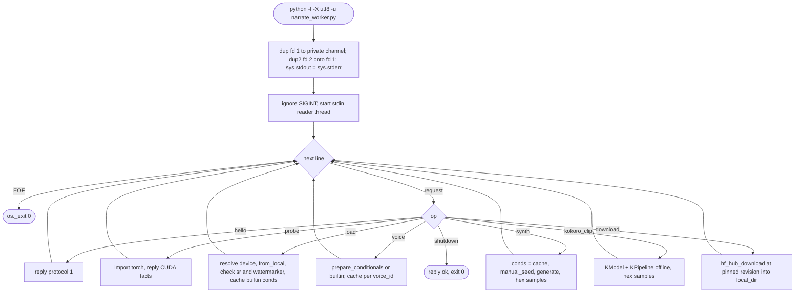

# spec-narrate-worker

## Metadata

| Field | Value |
|---|---|
| **Feature** | Python generation worker and the JSON-lines worker protocol (real worker and fake-worker conformance) |
| **Parent feature** | spec-narrate-architecture.md |
| **Sub-features** | None |
| **Requirement refs** | UR-001, UR-002, UR-004, FR-005, FR-007, FR-008, FR-009, FR-010, FR-012, FR-013, FR-018, NFR-002, NFR-005, NFR-006 |
| **Feature type** | Functionality |
| **Status** | Review |

Status values: Draft, Review, Approved, Implemented.

Change Log 2026-10-13 (end of this file) modifies Requirement 2 (stdin reader), Requirement 7 (CUDA release), and adds a repeated `load` after out of memory. Where the change log and the body differ, the change log wins.

## Description

`python/narrate_worker.py` is a single-file Python program that `narrate` embeds, writes to `<data>\worker\<h12>\narrate_worker.py`, and runs with the venv interpreter. It reads one JSON request per line on stdin and writes exactly one JSON response per request on a private copy of the original stdout, while every other output (library prints, warnings, tracebacks, progress) goes to stderr. It loads Chatterbox-Turbo from local pinned files, keeps one voice conditioning per voice, synthesizes chunks with the PerTh watermark always applied, renders Kokoro reference clips, and downloads pinned Hugging Face files for setup. The protocol is versioned (`protocol` 1) and is the only contract between `narrate` and any worker, so the developer-tester can implement a fake worker (`narrate-test-worker`) from this file alone.

## Triggered by

| Trigger type | Source | Condition |
|---|---|---|
| Called by feature | Generation (spec-narrate-generation.md) | One session per run: `hello`, `load`, `voice`, `synth` x N, `shutdown` |
| Called by feature | `status` (spec-narrate-setup.md) | Environment present: `hello`, `probe`, `shutdown` |
| Called by feature | Setup step `models` | `hello`, `download` x files to fetch, `shutdown` (online environment) |
| Called by feature | Setup step `voices` | `hello`, `kokoro_clip` x 2, `load`, `voice`, `synth`, `shutdown` (offline environment) |

## Required data

| Data | Source | Type | Notes |
|---|---|---|---|
| Interpreter | `<data>\venv\Scripts\python.exe` | Path | CPython 3.11.14 |
| Script | `<data>\worker\<h12>\narrate_worker.py` | Path | Written by `narrate` (temp then rename) when absent and the Python worker is used (never when `NARRATE_WORKER_CMD` is in effect); `<h12>` = first 12 hex of the script's sha256 |
| Command line | `narrate` | Args | `<python> -I -X utf8 -u <script>`; working directory `<data>`; creation flags `CREATE_NEW_PROCESS_GROUP \| CREATE_NO_WINDOW` (`0x00000200 \| 0x08000000`), so the worker has no console shared with `narrate` and never receives `CTRL_C_EVENT` or `CTRL_BREAK_EVENT`; assigned to `narrate`'s kill-on-close job object right after spawning |
| Environment | `narrate` | Variables | spec-narrate-setup.md (Child process environment) |
| Requests | stdin | JSON lines | Schemas below |

In test builds with `NARRATE_WORKER_CMD` set, `narrate` runs that executable with no arguments, the same working directory, creation flags, job object, stdio wiring, and environment.

## Preconditions

| Condition | Check | If not met |
|---|---|---|
| venv interpreter exists | Readiness check before spawn | Generation stops with `not-set-up`; worker never starts |
| Script materialized | `narrate` writes it if absent | Write failure: `data-dir-unwritable` (setup) or `worker-start` (generation) |
| Model files present (for `load`) | Readiness check | As above |

## Data flow

## Algorithmic steps

### Requirement 1: Protect the protocol channel

Before importing any third-party module, the worker SHALL duplicate file descriptor 1 into a private handle opened as UTF-8 text with `\n` line endings and line buffering, SHALL then point file descriptor 1 and `sys.stdout` at stderr, and SHALL write only protocol responses to the private handle (research F6).

#### Scenario: Library print does not corrupt the channel (GPU QA)

- **GIVEN** a real setup (Turbo's `from_local` prints to stdout, research F6)
- **WHEN** generation runs with `--verbose`
- **THEN** generation SHALL succeed with no `worker-protocol` error
- **AND** the library's printed text SHALL appear on `narrate`'s stderr as `worker: ` lines

#### Scenario: Non-ASCII text round-trips

- **GIVEN** a chunk text `Café, naïve [laugh]`
- **WHEN** `narrate` sends `synth`
- **THEN** the worker SHALL receive exactly that text (no cp1252 replacement), because it runs with `-X utf8` (research F6)

### Requirement 2: Lifetime and interruption

The worker SHALL ignore SIGINT (a second guard; its creation flags already keep console control events away from it), SHALL read stdin on a dedicated thread, SHALL call `os._exit(0)` as soon as stdin reaches end-of-file (even while a request is running), and SHALL exit 0 right after replying to `shutdown`.

#### Scenario: Parent gone

- **GIVEN** a worker in the middle of a `synth` request
- **WHEN** its stdin is closed
- **THEN** the worker process SHALL exit within 10 s

#### Scenario: Ctrl+C in the console

- **GIVEN** a running generation in an interactive console
- **WHEN** the Owner presses Ctrl+C
- **THEN** the worker SHALL receive no console control event (own process group, no console), SHALL NOT print a `KeyboardInterrupt` traceback, and SHALL exit when `narrate` closes its stdin or terminates it (spec-narrate-generation.md Requirement 13)

### Requirement 3: Framing and correlation

Every request and response SHALL be one JSON object encoded as UTF-8 on one line ending with `\n`; every request SHALL carry an integer `id` (1, 2, 3, ... per session) and a string `op`; the worker SHALL answer each request with exactly one response carrying the same `id` and a boolean `ok`, in request order; a failed request SHALL carry `error: {code, message, traceback}`; a line that is not a JSON object, or has an unknown `op` or missing fields, SHALL get `ok: false` with code `bad_request` and `id` echoed when present (else `null`).

#### Scenario: Error response shape

- **GIVEN** a running worker
- **WHEN** `narrate` sends `{"id":7,"op":"dance"}`
- **THEN** the worker SHALL reply `{"id":7,"ok":false,"error":{"code":"bad_request","message":"...","traceback":null}}` (message text free)

#### Scenario: Host rejects a mismatched id

- **GIVEN** a worker that replies with `id` 9 to request 2
- **WHEN** `narrate` reads the reply
- **THEN** `narrate` SHALL stop with `worker-protocol`, exit 1, and terminate the worker

### Requirement 4: Load the model on the chosen device

On `load`, the worker SHALL, in this order: honor `NARRATE_TEST_WATERMARK_FAIL=1` by replying `watermarker_unavailable` without loading; import `perth` and reply `watermarker_unavailable` if `perth.PerthImplicitWatermarker is None` (research F1: the class silently becomes `None` when `pkg_resources` is missing, and `ChatterboxTurboTTS.__init__` would then raise a `TypeError` that would otherwise surface as `model_load_failed`); resolve the device (`auto`: CUDA when `torch.cuda.is_available()`, else CPU with `fallback: true`; `cuda`: CUDA or error `cuda_unavailable`; `cpu`: CPU); call `ChatterboxTurboTTS.from_local(model_dir, device)` (research F4); verify `model.sr == 24000` and that `model.watermarker` is not `None` (reply `watermarker_unavailable` if it is); and keep the conditionals `from_local` loaded from `conds.pt` as the `builtin` voice before any other voice is prepared (research F7).

#### Scenario: CUDA hidden (GPU QA)

- **GIVEN** a real setup and `CUDA_VISIBLE_DEVICES=-1`
- **WHEN** the user runs `narrate script.txt --device auto`
- **THEN** stderr SHALL contain the fallback warning and `device: cpu`, and the run SHALL succeed

#### Scenario: CUDA forced but hidden (GPU QA)

- **GIVEN** a real setup and `CUDA_VISIBLE_DEVICES=-1`
- **WHEN** the user runs `narrate script.txt --device cuda`
- **THEN** the exit code SHALL be 1 with `error[cuda-unavailable]`

#### Scenario: Watermarker missing

- **GIVEN** `perth.PerthImplicitWatermarker` is `None` (for example `pkg_resources` absent, research F1) or `NARRATE_TEST_WATERMARK_FAIL=1`
- **WHEN** `load` runs
- **THEN** the reply SHALL be `ok: false` with code `watermarker_unavailable` (not `model_load_failed`), `from_local` SHALL NOT have been called, and no audio SHALL ever be produced by this session

### Requirement 5: One cached conditioning per voice

On `voice`, the worker SHALL, for `voice_id` `builtin`, use the conditionals kept at load (error `builtin_unavailable` if there were none), and for any other `voice_id`, call `model.prepare_conditionals` with the given clip path, exaggeration 0.0, and loudness normalization on (the values `generate` uses by default, research P1 section 1.3), then store `model.conds` under that `voice_id`; a later `voice` request for the same `voice_id` SHALL replace its entry (research F7).

#### Scenario: Builtin stays builtin after a clone

- **GIVEN** a session that prepared `female` and then `builtin`
- **WHEN** `synth` runs with `voice_id` `builtin`
- **THEN** the worker SHALL assign the builtin conditionals to `model.conds` before generating, not the female ones

#### Scenario: Clip rejected by the model

- **GIVEN** a clip that `prepare_conditionals` rejects (for example 5.0 s, research P1 section 1.5)
- **WHEN** `voice` runs
- **THEN** the reply SHALL be `ok: false` with code `voice_failed` and the library's message

### Requirement 6: Synthesize one chunk

On `synth`, the worker SHALL set `model.conds` to the cached conditioning for `voice_id` (error `bad_request` if not prepared), call `torch.manual_seed(seed)`, call `model.generate(text)` with no audio prompt and every other argument at the library default (temperature 0.8, top_k 1000, top_p 0.95, repetition_penalty 1.2, min_p 0.0, exaggeration 0.0, cfg_weight 0.0, norm_loudness True; research P1 section 1.3), and reply with the mono float32 samples as `pcm_f32le_hex`; the watermark that `generate` applies (research P1 section 1.3, line 295) SHALL NOT be removed or bypassed (FR-018). `NARRATE_TEST_FAIL_CHUNK=N` SHALL make `synth` for `chunk` N reply `test_failure`; `NARRATE_TEST_CRASH_CHUNK=N` SHALL make the worker call `os._exit(3)` on receiving `synth` for `chunk` N, without replying.

#### Scenario: Reply shape

- **GIVEN** a loaded model and a prepared voice
- **WHEN** `narrate` sends `synth` with `chunk` 2, `total` 5, `seed` 2
- **THEN** the reply SHALL have `chunk` 2, `sample_rate` 24000, `samples` >= 1, `synth_seconds` >= 0, and `pcm_f32le_hex` of exactly `samples x 8` lowercase hex characters

#### Scenario: Out of memory

- **GIVEN** CUDA memory runs out during `generate`
- **WHEN** `synth` runs
- **THEN** the reply SHALL be `ok: false` with code `out_of_memory`

#### Scenario: Watermark present (GPU QA)

- **GIVEN** a WAV produced by `narrate` on the real setup
- **WHEN** QA runs `qa/watermark/check_watermark.py` on it
- **THEN** the extracted watermark value SHALL be >= 0.5, and for the negative control `<data>\voices\female.wav` (Kokoro output, never watermarked) it SHALL be < 0.5

### Requirement 7: Render a Kokoro reference clip

On `kokoro_clip`, the worker SHALL build `KModel(repo_id="hexgrad/Kokoro-82M", config=<model_dir>\config.json, model=<model_dir>\kokoro-v1_0.pth)` on the resolved device in eval mode, `KPipeline(lang_code="a", repo_id="hexgrad/Kokoro-82M", model=<that model>)`, load the voice tensor with `torch.load(<model_dir>\voices\<voice>.pt, weights_only=True)`, call `torch.manual_seed(0)`, run the pipeline at speed 1 on the text, concatenate every result's audio, reply with the 24 kHz float32 samples, and then release the Kokoro objects and the CUDA cache (research P1 section 4).

#### Scenario: Offline clip render (GPU QA)

- **GIVEN** a setup run with the network disabled after step `models`
- **WHEN** step `voices` runs
- **THEN** both Kokoro clips SHALL render with no network request (`HF_HUB_OFFLINE=1`; `en_core_web_sm` is a locked package, research F2)

#### Scenario: Kokoro failure

- **GIVEN** Kokoro raises an exception (for example an incompatibility with transformers 5.2.0, unverified in research P1 section 4)
- **WHEN** `kokoro_clip` runs
- **THEN** the reply SHALL be `ok: false` with code `kokoro_failed`, and setup SHALL stop with `setup-step-failed` at step `voices`

### Requirement 8: Download one pinned file

On `download`, the worker SHALL call `huggingface_hub.hf_hub_download(repo_id=repo, filename=file, revision=revision, local_dir=local_dir)` and reply with the absolute path of the downloaded file, and SHALL reply `download_failed` naming `repo` and `file` on any exception; it SHALL NOT verify hashes (Rust does) and SHALL NOT move the file out of `local_dir`.

#### Scenario: Download succeeds

- **GIVEN** network access
- **WHEN** `narrate` sends `download` for `ResembleAI/chatterbox-turbo`, revision `749d1c1a46eb10492095d68fbcf55691ccf137cd`, file `conds.pt`, `local_dir` `<data>\staging\models\chatterbox-turbo`
- **THEN** the reply SHALL name `<data>\staging\models\chatterbox-turbo\conds.pt`

#### Scenario: Network drop

- **GIVEN** the network fails mid-transfer
- **WHEN** `download` runs
- **THEN** the reply SHALL be `ok: false` with code `download_failed` and a message containing the file name

### Requirement 9: Fake-worker conformance

Any executable used through `NARRATE_WORKER_CMD` SHALL implement every op in the Protocol schemas (`hello`, `probe`, `load`, `voice`, `synth`, `kokoro_clip`, `download`, `shutdown`), SHALL exit 0 on stdin end-of-file, and SHALL honor `NARRATE_TEST_FAIL_CHUNK`, `NARRATE_TEST_CRASH_CHUNK`, and `NARRATE_TEST_WATERMARK_FAIL` exactly as Requirements 4 and 6 define; for `download` it SHALL write a file at `local_dir` joined with `file` (creating parent directories) and reply with that path, and for `kokoro_clip` it SHALL reply with float32 samples at 24000 Hz; it MAY read its own configuration from variables prefixed `FAKE_WORKER_`, which `narrate` passes through unchanged.

Suggested knobs for `narrate-test-worker` (the developer-tester owns the final set): `FAKE_WORKER_LOG` (append every received request line and the worker PID), `FAKE_WORKER_ENV_DUMP` (write the environment as JSON at start), `FAKE_WORKER_DEVICE` (`cuda`, `cpu-fallback`, `cpu`, `cuda-unavailable`), `FAKE_WORKER_SAMPLES_PER_CHAR` (samples per text character for `synth`, default 100; setup tests raise it so the builtin clip reaches 240000 samples, or set it so only the doubled reference text does), `FAKE_WORKER_CLIP_SAMPLES` (samples for `kokoro_clip`, default 240000), `FAKE_WORKER_DOWNLOAD_DIR` (directory holding the fixture files `download` copies, laid out as `<repo with / replaced by __>\<file>`), `FAKE_WORKER_DOWNLOAD_PATH_OVERRIDE` (reply with this path instead, to test the staging-path check), `FAKE_WORKER_SYNTH_DELAY_MS`, `FAKE_WORKER_PROTOCOL` (value to report in `hello`), `FAKE_WORKER_FAIL_OP` (op to answer with a given error code), `FAKE_WORKER_TRACEBACK` (traceback text to put in error replies).

#### Scenario: Fake worker drives a full run

- **GIVEN** a ready (fabricated) data directory, a test build, and `NARRATE_WORKER_CMD` naming `narrate-test-worker.exe`
- **WHEN** the user runs `narrate script.txt`
- **THEN** the command SHALL exit 0 and write a WAV whose sample count equals the sum of the fake's returned `samples` plus the pauses

#### Scenario: Fake worker drives setup

- **GIVEN** a test build, the fake uv, `NARRATE_WORKER_CMD` naming `narrate-test-worker.exe`, fixture files for the 13 pinned paths, and test pins listing their sizes and sha256 values
- **WHEN** the user runs `narrate setup` on an empty scratch data directory
- **THEN** the command SHALL exit 0 and end with `setup: ready` (spec-narrate-setup.md, Scenario: First run and re-run with the fakes)

#### Scenario: Fake exits on stdin close

- **GIVEN** `narrate-test-worker.exe` started with piped stdin
- **WHEN** its stdin is closed without `shutdown`
- **THEN** it SHALL exit 0

## Protocol schemas

All requests: `{"id": <int>, "op": "<op>", ...fields}`. All success responses: `{"id": <int>, "ok": true, ...fields}`. All failures: `{"id": <int or null>, "ok": false, "error": {"code": "<code>", "message": "<one line>", "traceback": "<text or null>"}}`. Unknown extra fields are ignored by both sides. Numbers are JSON numbers; paths are absolute Windows paths as JSON strings.

| op | Request fields | Success response fields | Allowed error codes |
|---|---|---|---|
| `hello` | `protocol`: 1 | `protocol`: 1; `worker`: string (for example `narrate-worker 0.1.0`); `python`: string (for example `3.11.14`) | `bad_request` |
| `probe` | none | `cuda_available`: bool; `device_name`: string or null; `torch`: string (for example `2.6.0+cu124`) | `probe_failed` |
| `load` | `model_dir`: path; `device`: `auto` / `cuda` / `cpu` | `device`: `cuda` / `cpu`; `device_name`: string or null; `fallback`: bool; `load_seconds`: number | `cuda_unavailable`, `model_load_failed`, `watermarker_unavailable`, `out_of_memory` |
| `voice` | `voice_id`: string; `clip`: path or null (null only for `builtin`) | `voice_id`: string | `builtin_unavailable`, `voice_failed`, `bad_request` (before `load`) |
| `synth` | `chunk`: int >= 1; `total`: int >= `chunk`; `voice_id`: string; `text`: string; `seed`: int | `chunk`: int; `samples`: int >= 1; `sample_rate`: 24000; `synth_seconds`: number; `pcm_f32le_hex`: string | `synth_failed`, `test_failure`, `out_of_memory`, `bad_request` |
| `kokoro_clip` | `model_dir`: path; `voice`: `af_heart` / `am_michael`; `text`: string; `device`: `auto` / `cuda` / `cpu` | `samples`: int; `sample_rate`: 24000; `device`: `cuda` / `cpu`; `pcm_f32le_hex`: string | `kokoro_failed`, `cuda_unavailable`, `out_of_memory` |
| `download` | `repo`: string; `revision`: 40-hex string; `file`: repo-relative path with `/`; `local_dir`: path | `path`: path | `download_failed` |
| `shutdown` | none | none (then exit 0) | none |

`pcm_f32le_hex`: each sample is the 4 little-endian bytes of an IEEE-754 float32, each byte as two lowercase hex digits, samples in order with no separators. Example: `[1.0, -0.5]` encodes as `0000803f000000bf`.

## Business rules

| Rule ID | Rule | Traces to | Applied at step | Example |
|---|---|---|---|---|
| RULE-001 | Run with `-I -X utf8 -u`; `PYTHONUTF8` is ignored under `-I` (research F6) | FR-001 | Required data | |
| RULE-002 | Never pass a watermark-disabling argument; reject nothing that `generate` watermarks | FR-018 | Requirement 6 | |
| RULE-003 | Sampling parameters are the library defaults; no CLI option changes them | FR-005 | Requirement 6 | |
| RULE-004 | One request in flight at a time; replies in request order | FR-005 | Requirement 3 | |
| RULE-005 | `synth_seconds` measures only the `generate` call | NFR-012 | Requirement 6 | |
| RULE-006 | Error replies include `traceback` (Python's formatted traceback) for every exception-derived error; `narrate` shows it only under `--verbose` | NFR-007 | Requirement 3 | |

## Data transformations

| Input | Transformation | Output | Notes |
|---|---|---|---|
| `generate()` tensor `(1, n)` on CPU (research P1 section 1.3) | Squeeze, cast to little-endian float32, hex | `pcm_f32le_hex`, `samples` = n | |
| Kokoro result audio chunks | Concatenate, float32, hex | `pcm_f32le_hex` | 24 kHz (research P1 section 4) |

## Output / Outcome

| Output | Type | Description |
|---|---|---|
| Responses | JSON lines on the private stdout handle | Schemas above |
| Logs | stderr | Free text; `narrate` stores it in `<data>\logs\` |
| Downloaded files | Files in `local_dir` | `download` only |

## Error handling

| Error condition | Handling strategy | Outcome |
|---|---|---|
| Exception in an op | Catch, reply `ok: false` with the op's code, message, traceback | Session continues; `narrate` decides to stop |
| Malformed request | `bad_request` | `narrate` treats as `worker-protocol` |
| CUDA OOM | `out_of_memory` | `gpu-out-of-memory` |
| stdin EOF | `os._exit(0)` | Process ends; GPU memory released by process exit |
| Crash hook | `os._exit(3)` | `narrate` reports `worker-exited` |

Mapping of worker codes to CLI codes: `cuda_unavailable` to `cuda-unavailable`; `model_load_failed` to `model-load`; `watermarker_unavailable` to `watermark-unavailable`; `out_of_memory` to `gpu-out-of-memory`; `builtin_unavailable` and `voice_failed` to `voice-prepare`; `synth_failed` and `test_failure` to `chunk-failed`; `bad_request` to `worker-protocol`; `kokoro_failed`, `download_failed` to `setup-step-failed`; `probe_failed` to the status line `cuda: unknown (probe failed)`. During setup every worker error maps to `setup-step-failed` with the step name.

## Events emitted

| Event name | Payload | Consumer(s) | When emitted |
|---|---|---|---|
| Responses | Schemas above | `narrate` | One per request |

## Events consumed

| Event name | Producer | Payload used | Handling |
|---|---|---|---|
| Requests | `narrate` | Schemas above | Requirements 3 to 8 |

## Sub-feature breakdown

Not applicable.

## Performance considerations

| Concern | Target | Approach |
|---|---|---|
| Model load | Once per run; time reported as `load_seconds` (unverified, research P1 Unverified list) | `from_local` once per session |
| Per-chunk overhead | Small against synthesis time (estimate) | Cached conditioning; no re-load |
| Transport size | About 3.8 MB of hex per 20 s chunk (estimate: 480000 samples x 8 characters) | `narrate` accepts lines up to 32 MiB |

## Traceability

| Requirement | Spec section | Verified by |
|---|---|---|
| FR-005 | Requirements 2, 3, 6, 9 | `crates/narrate/tests/chunks.rs`, `crates/narrate/tests/interrupt.rs`, GPU QA |
| FR-007, FR-008, FR-009 | Requirement 5 | `crates/narrate/tests/voices.rs` (requests), GPU QA (pitch) |
| FR-010 | Requirements 7, 8, 9 (fake `download` and `kokoro_clip`) | `crates/narrate/tests/setup_steps.rs` with the fake worker; GPU QA real setup |
| FR-012 | Requirements 7, 8 (offline split) | GPU QA offline run |
| FR-013 | Requirement 4 | `crates/narrate/tests/device.rs`, GPU QA with `CUDA_VISIBLE_DEVICES=-1` |
| FR-018 | Requirements 4 (watermarker checked before `from_local`), 6 | `crates/narrate/tests/device.rs` (hook), GPU QA watermark extractor |
| NFR-002 | Required data (environment) | GPU QA snapshot |
| NFR-005, NFR-006 | Performance considerations | GPU QA 10,000-word run, RTF |
| FR-005 (2026-10-13) | Change Log 2026-10-13: Requirement 2 (polled stdin reader) | `crates/narrate/tests/interrupt.rs` (worker gone after parent killed, with the fake); GPU QA items 3 and 10 (real worker: probe completes, worker gone within 10 s) |
| FR-010 (2026-10-13) | Change Log 2026-10-13: Requirement 7 (`release_cuda`), ADDED Requirement (repeated `load`) | `setup_steps.rs` (out-of-memory retry with the fake); GPU QA real setup |

## Change Log: 2026-10-13

**Source:** Implementation findings from plan step 3a against FR-005 (worker lifetime) and FR-010 (setup voices step), and the setup change of the same date (spec-narrate-setup.md, Change Log 2026-10-13, Requirement 5). `docs/requirements.md` is unchanged.

### ADDED Requirements

#### Requirement: Another `load` after out of memory

After a `load` answered with `out_of_memory`, the worker SHALL have released CUDA memory with `release_cuda` (defined below) and SHALL accept another `load` request in the same session, on any device, as if no model had been loaded.

##### Scenario: CPU load after a CUDA out-of-memory

- **GIVEN** a worker session whose first `load` with device `auto` was answered with `out_of_memory`
- **WHEN** `narrate` sends `load` with device `cpu`
- **THEN** the worker SHALL load the model on the CPU and reply `ok: true` with `device` `cpu`

### MODIFIED Requirements

#### Requirement 2: Lifetime and interruption (stdin reader)

**Was:** "The worker SHALL ignore SIGINT (a second guard; its creation flags already keep console control events away from it), SHALL read stdin on a dedicated thread, SHALL call `os._exit(0)` as soon as stdin reaches end-of-file (even while a request is running), and SHALL exit 0 right after replying to `shutdown`."
**Now:** The worker SHALL ignore SIGINT, SHALL read stdin on a dedicated thread that never blocks inside a read of a pipe, SHALL call `os._exit(0)` as soon as stdin reaches end-of-file (even while a request is running), and SHALL exit 0 right after replying to `shutdown`. When stdin is a pipe (`GetFileType` on the handle from `msvcrt.get_osfhandle(0)` returns `FILE_TYPE_PIPE`, value 3), the thread polls it with `PeekNamedPipe` (through `ctypes`) about every 5 ms. It calls `os.read(0, n)` only for the `n` bytes reported available, at most 1 MiB per read, splits the bytes into lines, and queues each complete line for the main thread. When `PeekNamedPipe` fails (broken pipe: the parent closed its end) or a read returns no bytes, the thread calls `os._exit(0)`. When stdin is a console or a file (manual runs), a blocking read is allowed.
**Reason:** In step 3a, on Windows with CPython 3.11.14, a thread blocked in `readline()` on the stdin pipe deadlocked `import numpy` and `import torch` in the main thread (reproduced). Polling keeps the pipe free while the main thread imports.

##### Scenario: Heavy imports while the reader waits (GPU QA)

- **GIVEN** a real setup
- **WHEN** the user runs `narrate status`, whose probe imports `torch` while the reader thread waits for the next request
- **THEN** the `cuda:` line SHALL be `available (...)` or `not available (...)`, never `unknown (probe failed)`, and status SHALL finish within 120 s

##### Scenario: Parent gone (unchanged bound)

- **GIVEN** a worker in the middle of a `synth` request
- **WHEN** its stdin pipe is closed
- **THEN** the worker process SHALL exit within 10 s

#### Requirement 7: Render a Kokoro reference clip (CUDA release)

**Was:** "... reply with the 24 kHz float32 samples, and then release the Kokoro objects and the CUDA cache (research P1 section 4)."
**Now:** Everything else in Requirement 7 is unchanged. "Release the CUDA cache" means calling `release_cuda`, which the worker SHALL also call after every `out_of_memory` in `load`, `synth`, or `kokoro_clip`. `release_cuda` runs `gc.collect()`, then, only if `torch.cuda.is_available()`, calls `torch.backends.cuda.cufft_plan_cache.clear()` before `torch.cuda.empty_cache()`. It never fails a request. The worker honors any `device` value in `kokoro_clip`; setup sends `"cpu"` (spec-narrate-setup.md, Change Log 2026-10-13, Requirement 5).
**Reason:** In step 3a, Kokoro on CUDA stalled in `torch.istft` after `torch.cuda.empty_cache()` while cuFFT plans still held freed workspace (torch 2.6.0+cu124); clearing the cuFFT plan cache first fixed it.

##### Scenario: Kokoro clip after a CUDA release (GPU QA)

- **GIVEN** a real setup with the clips deleted
- **WHEN** `narrate setup` runs step `voices`
- **THEN** both Kokoro clips and the builtin clip SHALL be written and the step SHALL finish within 10 minutes (estimate; a stall shows as no progress)

### REMOVED Requirements

None.
